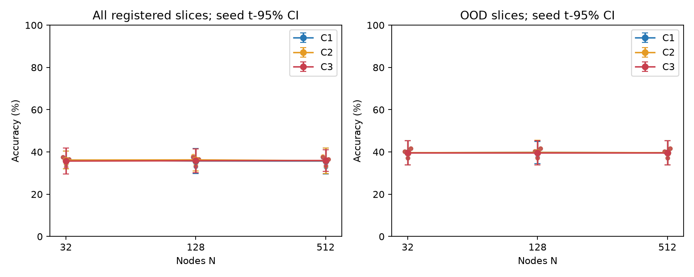
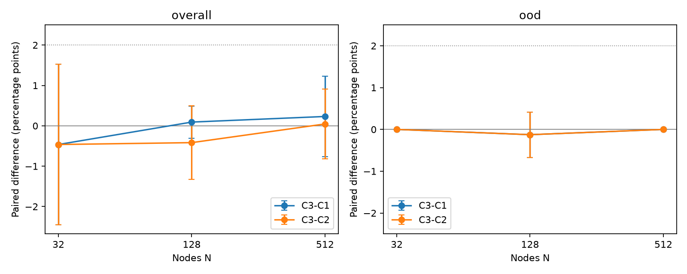
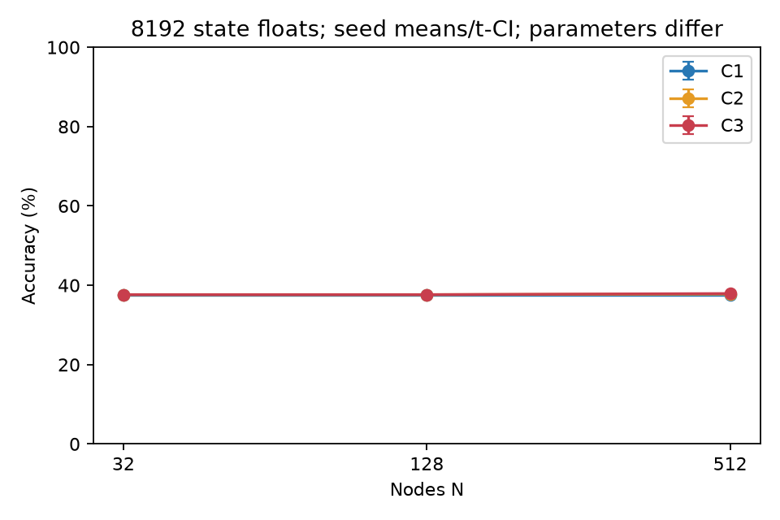
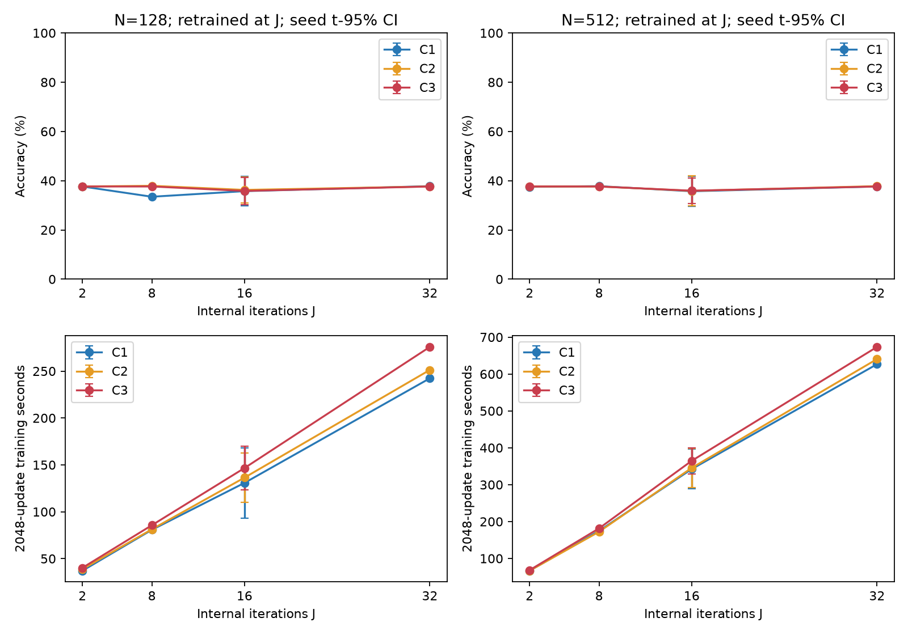
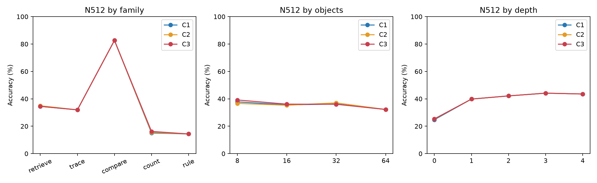
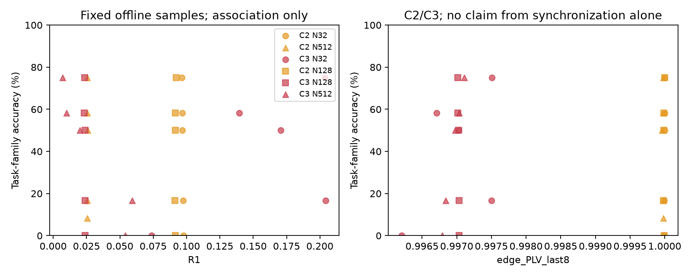
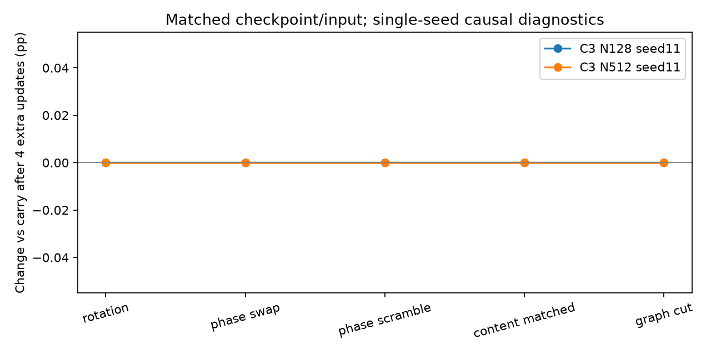
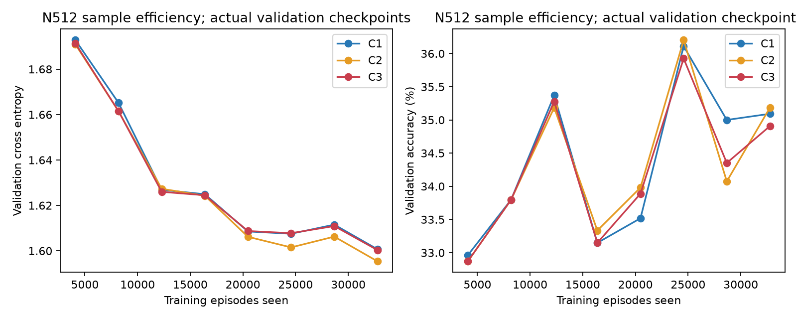
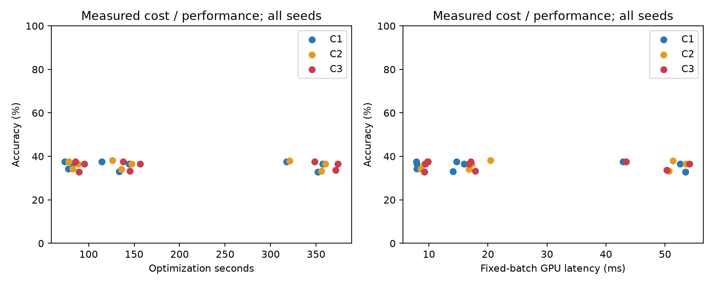
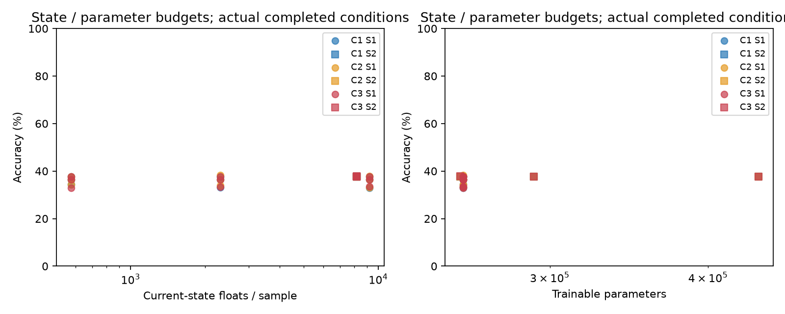

# Bio-Matrix v0.3 网络规模实验结果

> 归档说明：本文保留写作时点的设计或状态。项目已停止v0.9后续训练；最新执行状态见[实验索引](RESULTS_INDEX.md)。公开副本不含权重与语料。

主扫描27次已完成（三架构×三个节点规模×三个种子）。N512的C3为35.93%，C1为35.69%，配对差+0.23个百分点；主要OOD差+0.00个百分点。本轮保持初筛身份，结合基线、连续损失与成本判断，不把单个正差值当成成功。

生成时间（UTC）：2026-10-21T17:16:44.064146+00:00。仅汇总有完整 result.json 的运行；部分运行、失败与中止不混入完成均值。

分支：`bio-matrix-v03-network-scale`。首轮23份源文件与327份结果的SHA256复核无变化。首轮报告快照、预登记、实现说明分别见同目录文件。

## 执行状态

下表计当前已登记的81个网络训练条件；原计划81个，P2/P3追加90个，总目标171个。输入独立基线与后续工作项另列，不将一个工作组当作一次模型训练。

| 状态 | 条件数 |
|---|---:|
| completed | 81 |
| running | 0 |
| failed | 0 |
| aborted | 0 |
| not_executed | 0 |

历史失败/中止事件：1。当前完成状态不抹去历史事件；完整记录见 conditions.json。P0首次图切分实现检查失败已修复；旧验证程序最终硬件查询被沙箱阻止，已用独立只读哈希复核完成档案检查，未改写首轮结果。

P0：7项主实现检查，另补4项对照/隔离/反事实/重复计划检查；与旧测试合计21项逻辑检查。初次沙箱回归有1项MPS检查跳过，最终复核日志见P0/final_tests.log；另在真实MPS执行正反向一致性和9组剖析。最大CPU/MPS梯度绝对误差7.45e-8。训练使用MPS float32，无隐式CPU回退。

## 主规模扫描

每格为准确率均值 ± 跨训练种子的样本SD。区间图为跨种子的t-95%区间，n=3时很不稳定；测试问题数不作为独立训练次数。OOD包括M64、深度4、保留关系组合。

| N | 架构 | 完成种子 | 全切片准确率 | OOD准确率 | CE | 优化秒/次 |
|---:|---|---|---:|---:|---:|---:|
| 32 | C1 | 37,23,11 | 36.16% ± 1.70 (n=3) | 39.65% ± 2.31 (n=3) | 1.5422 | 78.25 |
| 32 | C2 | 11,37,23 | 36.16% ± 1.70 (n=3) | 39.65% ± 2.31 (n=3) | 1.5419 | 83.02 |
| 32 | C3 | 23,37,11 | 35.69% ± 2.47 (n=3) | 39.65% ± 2.31 (n=3) | 1.5422 | 89.99 |
| 128 | C1 | 11,23,37 | 35.74% ± 2.39 (n=3) | 39.77% ± 2.11 (n=3) | 1.5419 | 130.82 |
| 128 | C2 | 23,37,11 | 36.25% ± 2.10 (n=3) | 39.77% ± 2.37 (n=3) | 1.5414 | 136.42 |
| 128 | C3 | 37,23,11 | 35.83% ± 2.24 (n=3) | 39.65% ± 2.31 (n=3) | 1.5423 | 146.64 |
| 512 | C1 | 11,23,37 | 35.69% ± 2.47 (n=3) | 39.65% ± 2.31 (n=3) | 1.5422 | 342.30 |
| 512 | C2 | 23,37,11 | 35.88% ± 2.43 (n=3) | 39.65% ± 2.31 (n=3) | 1.5376 | 345.54 |
| 512 | C3 | 37,23,11 | 35.93% ± 2.08 (n=3) | 39.65% ± 2.31 (n=3) | 1.5422 | 364.66 |

## 相位收益与规模交互

差值以百分点表示，正数有利于C3。逐种子差值保存在summary.json；规模交互为[N512的差值]−[N32的差值]。

| 对比 | N | 全切片差值 ± SD | OOD差值 ± SD |
|---|---:|---:|---:|
| C3−C1 | 32 | -0.46% ± 0.80 (n=3) | 0.00% ± 0.00 (n=3) |
| C3−C1 | 128 | 0.09% ± 0.16 (n=3) | -0.13% ± 0.22 (n=3) |
| C3−C1 | 512 | 0.23% ± 0.40 (n=3) | 0.00% ± 0.00 (n=3) |
| C3−C1 规模交互 | 512−32 | 0.69% ± 1.20 (n=3) | 0.00% ± 0.00 (n=3) |
| C3−C2 | 32 | -0.46% ± 0.80 (n=3) | 0.00% ± 0.00 (n=3) |
| C3−C2 | 128 | -0.42% ± 0.37 (n=3) | -0.13% ± 0.22 (n=3) |
| C3−C2 | 512 | 0.05% ± 0.35 (n=3) | 0.00% ± 0.00 (n=3) |
| C3−C2 规模交互 | 512−32 | 0.51% ± 1.13 (n=3) | 0.00% ± 0.00 (n=3) |

不能仅凭单个正差值、同步曲线或某个显著阈值宣称成功。未做五种子确认时，本轮保持初筛身份。若问题独立基线接近网络分数、关系任务未打通，当前结果不能用于否定相位机制。少量种子准确率差全为零时，样本SD和t区间也会退化为零，不代表已经精确证明总体差异为零。

## 答案先验与输入独立基线

开发集选择的多数类在测试上：36.67%（OOD 40.15%）；按开发分布随机答案的期望：32.42%。机会水平随任务与答案分布变化，不沿用首轮25%。
- question_only：35.05% ± 1.16 (n=3)（OOD 37.50% ± 1.65 (n=3)），平均CE 1.5533；各2048步，单独训练的泄漏/先验诊断，非严格等参数核心对照。
- evidence_only：15.88% ± 0.08 (n=3)（OOD 23.11% ± 0.00 (n=3)），平均CE 3.0745；各2048步，单独训练的泄漏/先验诊断，非严格等参数核心对照。

## 固定容量、迭代与拓扑

先完成种子11配对，再按补充登记对所有条件补23/37。表中均值、样本SD与n来自实际完成的种子；n=1时不构造区间，三种子仍为初筛。S2精确匹配N(d+2)=8192，但不等参数或计算；使用32维分解自反馈，仍逐项报告参数和实际成本。

| 阶段 | 架构 | N | d | J | 图 | 准确率 ± SD | 平均CE | 参数 | 当前状态浮点数 | 平均优化秒 |
|---|---|---:|---:|---:|---|---:|---:|---:|---:|---:|
| capacity | C1 | 32 | 254 | 16 | connected | 37.64% (n=1) | 1.5353 | 438235 | 8192 | 111.03 |
| capacity | C1 | 128 | 62 | 16 | connected | 37.64% (n=1) | 1.5374 | 291547 | 8192 | 161.94 |
| capacity | C1 | 512 | 14 | 16 | connected | 37.64% (n=1) | 1.5349 | 254875 | 8192 | 362.28 |
| capacity | C2 | 32 | 254 | 16 | connected | 37.64% (n=1) | 1.5348 | 438235 | 8192 | 110.54 |
| capacity | C2 | 128 | 62 | 16 | connected | 37.64% (n=1) | 1.5379 | 291547 | 8192 | 169.51 |
| capacity | C2 | 512 | 14 | 16 | connected | 37.78% (n=1) | 1.5345 | 254875 | 8192 | 360.07 |
| capacity | C3 | 32 | 254 | 16 | connected | 37.64% (n=1) | 1.5343 | 438236 | 8192 | 116.84 |
| capacity | C3 | 128 | 62 | 16 | connected | 37.64% (n=1) | 1.5376 | 291548 | 8192 | 175.96 |
| capacity | C3 | 512 | 14 | 16 | connected | 37.92% (n=1) | 1.5348 | 254876 | 8192 | 321.37 |
| iterations | C1 | 128 | 16 | 2 | connected | 37.64% (n=1) | 1.5379 | 256403 | 2304 | 37.10 |
| iterations | C1 | 128 | 16 | 8 | connected | 33.47% (n=1) | 1.5610 | 256403 | 2304 | 80.75 |
| iterations | C1 | 128 | 16 | 32 | connected | 37.78% (n=1) | 1.5367 | 256403 | 2304 | 242.33 |
| iterations | C1 | 512 | 16 | 2 | connected | 37.50% (n=1) | 1.5398 | 256403 | 9216 | 66.68 |
| iterations | C1 | 512 | 16 | 8 | connected | 37.78% (n=1) | 1.5366 | 256403 | 9216 | 174.77 |
| iterations | C1 | 512 | 16 | 32 | connected | 37.64% (n=1) | 1.5237 | 256403 | 9216 | 626.62 |
| iterations | C2 | 128 | 16 | 2 | connected | 37.64% (n=1) | 1.5381 | 256403 | 2304 | 38.74 |
| iterations | C2 | 128 | 16 | 8 | connected | 37.92% (n=1) | 1.5385 | 256403 | 2304 | 81.33 |
| iterations | C2 | 128 | 16 | 32 | connected | 37.64% (n=1) | 1.5389 | 256403 | 2304 | 251.25 |
| iterations | C2 | 512 | 16 | 2 | connected | 37.64% (n=1) | 1.5378 | 256403 | 9216 | 66.66 |
| iterations | C2 | 512 | 16 | 8 | connected | 37.64% (n=1) | 1.5369 | 256403 | 9216 | 172.40 |
| iterations | C2 | 512 | 16 | 32 | connected | 37.78% (n=1) | 1.5373 | 256403 | 9216 | 640.50 |
| iterations | C3 | 128 | 16 | 2 | connected | 37.64% (n=1) | 1.5385 | 256404 | 2304 | 40.21 |
| iterations | C3 | 128 | 16 | 8 | connected | 37.64% (n=1) | 1.5414 | 256404 | 2304 | 85.66 |
| iterations | C3 | 128 | 16 | 32 | connected | 37.64% (n=1) | 1.5376 | 256404 | 2304 | 275.80 |
| iterations | C3 | 512 | 16 | 2 | connected | 37.64% (n=1) | 1.5379 | 256404 | 9216 | 68.24 |
| iterations | C3 | 512 | 16 | 8 | connected | 37.64% (n=1) | 1.5384 | 256404 | 9216 | 181.58 |
| iterations | C3 | 512 | 16 | 32 | connected | 37.64% (n=1) | 1.5373 | 256404 | 9216 | 673.43 |
| topology | C1 | 128 | 16 | 16 | cut | 37.64% (n=1) | 1.5250 | 256403 | 2304 | 136.43 |
| topology | C1 | 128 | 16 | 16 | rewired | 37.64% (n=1) | 1.5379 | 256403 | 2304 | 137.83 |
| topology | C1 | 512 | 16 | 16 | cut | 37.64% (n=1) | 1.5379 | 256403 | 9216 | 353.43 |
| topology | C1 | 512 | 16 | 16 | rewired | 37.64% (n=1) | 1.5385 | 256403 | 9216 | 360.69 |
| topology | C2 | 128 | 16 | 16 | cut | 37.50% (n=1) | 1.5207 | 256403 | 2304 | 140.38 |
| topology | C2 | 128 | 16 | 16 | rewired | 37.78% (n=1) | 1.5359 | 256403 | 2304 | 141.45 |
| topology | C2 | 512 | 16 | 16 | cut | 37.64% (n=1) | 1.5368 | 256403 | 9216 | 363.58 |
| topology | C2 | 512 | 16 | 16 | rewired | 37.64% (n=1) | 1.5340 | 256403 | 9216 | 352.20 |
| topology | C3 | 128 | 16 | 16 | cut | 37.64% (n=1) | 1.5370 | 256404 | 2304 | 150.50 |
| topology | C3 | 128 | 16 | 16 | rewired | 37.78% (n=1) | 1.5371 | 256404 | 2304 | 150.43 |
| topology | C3 | 512 | 16 | 16 | cut | 37.64% (n=1) | 1.5358 | 256404 | 9216 | 381.54 |
| topology | C3 | 512 | 16 | 16 | rewired | 37.64% (n=1) | 1.5372 | 256404 | 9216 | 367.86 |

J16训练后改变测试轮数的原始结果见各主运行diagnostics.json/test_time_iterations；与重训练J2/8/32严格区分。图切分保持8度但仍共享证据读取和最终读出，因此不等于隔绝所有信息通道。

## 公开任务：CLEVR-SG 派生验证

来源：[CLEVR官方页面](https://cs.stanford.edu/people/jcjohns/clevr/)，CC BY 4.0，官方无图像包SHA256 `d4435dceab30022b64f7d34b3ec217162bfc1c2950c79999784750ced22674c4`。固定50,000训练问题，按场景划分开发1500/测试3000问题；场景/问题ID、哈希和1000个程序离线标签校验保存在data/clevr/v03_manifest.json。神经输入不包含程序，保留原始问题文本。

提供了真值对象和关系，故不是标准图像VQA，也不证明物体绑定涌现。2048×16=32,768次样本曝光，按固定子集有放回采样，未覆盖完整一轮训练集；不能将欠训练等同于架构能力上限。CoGenT未执行。

| N | 架构 | 准确率 ± SD | 平均CE | 完成种子 |
|---:|---|---:|---:|---|
| 128 | C1 | 44.23% (n=1) | 0.9867 | 11 |
| 128 | C2 | 44.33% (n=1) | 0.9855 | 11 |
| 128 | C3 | 42.67% (n=1) | 1.0039 | 11 |
| 512 | C1 | 44.70% (n=1) | 0.9871 | 11 |
| 512 | C2 | 44.87% (n=1) | 0.9891 | 11 |
| 512 | C3 | 42.80% (n=1) | 1.0073 | 11 |

## 分任务与机制诊断

切片来自预先固定的六组条件，M、深度、干扰不是完全正交；完整各条件逐任务/M/深度/干扰表见summary.json，不只展示有利切片。OOD指训练分布之外，开发集也包含同类型难度用于选择检查点，因此不称为开发阶段完全未见的分布。

R1/R2/R4、图边余弦、最后8轮PLV与逐样本表现见diagnostics.json。PLV高可能只是稳定相位差；关联不证明功能分工。干预在同一检查点、同一输入上进行，立即与恢复4轮分开，carry对照也获得相同4轮。内容扰动匹配相位交换的总L2能量，不等于函数破坏完全相同。关κ需结合重训C2解释。

| 架构 | N | 关κ准确率变化(pp) | 关辅助消息门变化(pp) | 同问题换证据后预测变化比例 | 平均预测分布TV |
|---|---:|---:|---:|---:|---:|
| C1 | 128 | +0.00 | +0.00 | 0.00% | 0.000001 |
| C1 | 512 | +0.00 | +0.00 | 0.00% | 0.000000 |
| C2 | 32 | +0.00 | +0.00 | 0.00% | 0.000020 |
| C2 | 512 | +0.00 | +0.00 | 6.78% | 0.016946 |
| C3 | 32 | +0.00 | +0.00 | 0.00% | 0.000007 |
| C2 | 128 | +0.00 | +0.00 | 1.69% | 0.003349 |
| C3 | 128 | +0.00 | +0.00 | 0.00% | 0.000180 |
| C1 | 32 | +0.00 | +0.00 | 0.00% | 0.000018 |
| C3 | 512 | +0.00 | +0.00 | 0.00% | 0.000073 |

上表为种子11的事后机制诊断。保持问题/物体ID、重新抽取合法属性和关系直到答案改变，不用于选择模型或作新的主准确率。关辅助消息门在C1关闭非周期门、C2/C3关闭相位门；读出仍保留辅助统计。关闭内容消息不等于完全关闭所有辅助通信。所有测试时消融都有分布偏移限制。

## 成本与证据边界

主运行等数据曝光、同图/角色/读取规则/当前状态维数，C3多一个活跃κ参数。所有MPS计时边界同步。完整推理包含编码器，固定16个相同输入；训练数据处理、评测、检查点时间与优化时间分开。内存为采样值，可能漏过瞬时峰值，tensor/driver不相加；进程RSS峰值为串行训练进程的累计峰值，不是可重置的单条件瞬时峰值。当前状态大小之外还有证据缓存、固定角色、初始相位、图索引和反向激活。

当前没有等实际训练时间的独立重训练控制；成本图用于呈现代价，不代替等时间胜利的证据。固定容量组参数变化仍是限制。三种子初筛不代替五种子确认；流式记忆、CoGenT、固定/动态专家、二阶/概率/新优化器均未在本轮展开。

明确未执行的后续工作（也保存为unexecuted_work.json）：

- P1_confirmation：53/71两个追加种子；未作五种子确认。
- C0_C4：训练匹配的独立无通信网络与共同clock控制。
- A_stream_CoGenT：流式持久记忆与CoGenT组合验证。
- P4_P5：固定稀疏专家、动态微专家与二阶/概率/多频率/新优化器。
- P2_P3_repeated_seeds：种子23/37还有90/90个追加条件未完成；具体状态逐项保存在unexecuted_work.json。

## 文件与重现

- [原始条件状态](../results/v03/conditions.json)
- [汇总与全部切片](../results/v03/summary.json)
- 串行控制台（本地留存：`results/v03/experiment_console.log`）

命令：`.venv/bin/python -m v03.profile`；`.venv/bin/python -m v03.run --stage all --dry-run`；`.venv/bin/python -m v03.run --stage all`；训练结束后执行`.venv/bin/python -m v03.baselines`、`.venv/bin/python -m v03.diagnose`、`.venv/bin/python -m v03.report`。不要同时启动多个训练进程。
