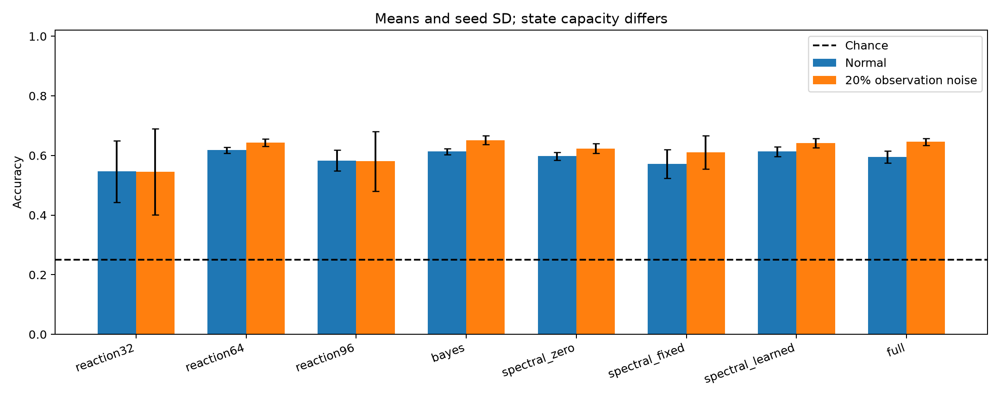

# Bio-Matrix 完整首轮研究结果

> 归档说明：本文保留写作时点的设计或状态。项目已停止v0.9后续训练；最新执行状态见[实验索引](../../docs/RESULTS_INDEX.md)。公开副本不含权重与语料。

核心状态实验21次，概率/频率/容量控制24次，周期预测9次；全部使用MPS。另做CPU解析函数120次和固定小网络12次优化器实验。每项均保留配置与原始结果。

## Q1：递推状态是否保存了可读取的信息？

核心实验的2/4键延迟24事件为主指标，理论机会水平25%。以下为三个种子的均值：

| 模型 | 保留 | 清零 | 交换 |
|---|---:|---:|---:|
| gru_add | 53.7% | 24.8% | 23.9% |
| linear_add | 74.3% | 24.6% | 23.0% |
| gated_add | 59.9% | 25.2% | 22.8% |
| reaction_add | 61.5% | 24.7% | 23.3% |
| gru_dynamic | 61.1% | 25.6% | 24.6% |
| gated_dynamic | 66.6% | 24.0% | 22.2% |
| reaction_dynamic | 54.8% | 24.9% | 22.0% |

这项任务中模型没有Attention或KV缓存。干预发生在查询之前，查询只携带键而无值；因此保留与清零的差异直接检验历史状态的作用。

## Q2/Q3：二阶反应与动态矩阵是否提供增量收益？

| 配对比较（前者减后者） | 平均准确率差，百分点 | 三个种子的差值 |
|---|---:|---|
| gated_add_minus_linear_add | -14.42 | +0.49, -32.32, -11.43 |
| reaction_add_minus_gated_add | +1.66 | -0.88, -0.29, +6.15 |
| reaction_dynamic_minus_gated_dynamic | -11.78 | -1.95, -33.30, -0.10 |
| gru_dynamic_minus_gru_add | +7.36 | +3.81, +6.45, +11.82 |
| reaction_dynamic_minus_reaction_add | -6.71 | +0.68, -0.29, -20.51 |
| reaction_dynamic_minus_gru_dynamic | -6.25 | +4.10, -6.35, -16.50 |

GRU增加动态矩阵后，3/3个种子提高准确率，平均提高7.36个百分点。在动态读出下加入二阶反应项，3/3个种子反而降低准确率。当前结果支持继续复测动态读出，但没有证明二阶反应的稳定增量价值。

Gated与Reaction的差别为二阶乘性项；Add与Dynamic有相同的参数数和非线性输出头。GRU和Reaction循环参数量不同，因此不把这些结果描述为严格等参数或等FLOPs胜利。

## Q4：概率与频率扩展是否有额外收益？

这部分全部重训2000步，25%训练样本为有噪声重复观测，不能与核心4000步分数直接混排。括号为种子样本标准差。64/96维确定性模型用于检查额外状态容量的影响。

| 模型 | 参数 | 状态浮点数 | 正常2/4键延迟24 | 20%噪声准确率 | 35%噪声准确率 | 20%噪声清零 | 优化秒/次 |
|---|---:|---:|---:|---:|---:|---:|---:|
| reaction32 | 10,308 | 32 | 54.6% (10.3%) | 54.6% (14.5%) | 46.7% | 24.6% | 15.89 |
| reaction64 | 19,844 | 64 | 61.8% (1.0%) | 64.3% (1.3%) | 54.7% | 26.2% | 16.03 |
| reaction96 | 33,476 | 96 | 58.3% (3.5%) | 58.1% (10.1%) | 50.5% | 26.2% | 16.98 |
| bayes | 12,452 | 64 | 61.3% (1.0%) | 65.1% (1.5%) | 56.0% | 26.4% | 62.68 |
| spectral_zero | 12,932 | 64 | 59.8% (1.4%) | 62.4% (1.6%) | 53.5% | 25.1% | 30.17 |
| spectral_fixed | 12,932 | 64 | 57.2% (4.8%) | 61.1% (5.6%) | 52.0% | 23.2% | 30.44 |
| spectral_learned | 12,948 | 64 | 61.3% (1.6%) | 64.2% (1.6%) | 55.3% | 24.6% | 33.06 |
| full | 15,092 | 96 | 59.5% (2.1%) | 64.6% (1.2%) | 55.6% | 23.2% | 78.49 |

概率版本相对64维普通状态，20%噪声准确率差为+0.78个百分点，优化耗时为3.91倍。

Gaussian版本采用对角EKF线性化与学习得到的伪观测，尚未做概率校准；因此分数变化不能单独解释为“模型理解了知识的不确定性”。另一个限制是尚无保留同一伪观测结构、仅替换方差更新的点估计对照，不能把差异完全归因于不确定性。

## 周期预测：频率机制的独立检验

| 状态 | 同频率16步 MSE | 同频率64步 MSE | 未见频率16步 MSE | 观测噪声0.2 MSE | 同频率16步清零 MSE |
|---|---:|---:|---:|---:|---:|
| spectral_zero | 0.26534 | 0.36064 | 0.21408 | 0.28290 | 0.39886 |
| spectral_fixed | 0.19604 | 0.95699 | 0.17661 | 0.22103 | 0.40245 |
| spectral_learned | 0.19687 | 0.77370 | 0.17706 | 0.22450 | 0.41751 |

本轮振荡状态在16步预测上更好，但64步外推更差；短期周期拟合收益没有转化为更长预测优势。

输入只提供前16个观测值，预测段全部缺失；成功也只支持周期结构利用，不能外推为语言记忆。

## 独立优化器测试

| 函数 | 方法 | 成功次数/10 | 最终损失均值 ± SD | 最好损失均值 | 秒/次 |
|---|---|---:|---:|---:|---:|
| rosenbrock | adam | 0 | 0.38691 ± 0.79555 | 0.38691 | 0.096 |
| rosenbrock | adam_cosine | 0 | 0.86943 ± 1.472 | 0.86943 | 0.096 |
| rosenbrock | gaussian_cosine | 1 | 0.62735 ± 1.0796 | 0.59942 | 0.117 |
| rosenbrock | gaussian_periodic_cosine | 1 | 0.61918 ± 1.0697 | 0.59563 | 0.138 |
| rastrigin | adam | 0 | 5.8702 ± 3.3314 | 5.8702 | 0.086 |
| rastrigin | adam_cosine | 0 | 5.8702 ± 3.3314 | 5.8702 | 0.086 |
| rastrigin | gaussian_cosine | 0 | 5.8702 ± 3.3314 | 5.8702 | 0.107 |
| rastrigin | gaussian_periodic_cosine | 0 | 5.8702 ± 3.3314 | 5.8702 | 0.126 |
| ackley | adam | 0 | 5.338 ± 1.6157 | 5.338 | 0.118 |
| ackley | adam_cosine | 0 | 5.338 ± 1.6157 | 5.338 | 0.117 |
| ackley | gaussian_cosine | 0 | 0.054934 ± 0.0010161 | 0.049416 | 0.141 |
| ackley | gaussian_periodic_cosine | 0 | 0.055335 ± 0.002107 | 0.051474 | 0.157 |

| 固定XOR小网络的方法 | 测试准确率 | CE | 秒/次 |
|---|---:|---:|---:|
| adam | 98.1% | 0.11729 | 0.094 |
| adam_cosine | 97.7% | 0.15870 | 0.092 |
| gaussian_cosine | 98.0% | 0.13942 | 0.130 |
| gaussian_periodic_cosine | 98.0% | 0.13941 | 0.162 |

滤波和周期方法具有额外状态与计算；每个方法的梯度/函数调用预算相同，但没有声称等时间。所有解析函数只用2维测试，结果不能外推到大模型优化或保证全局最优。

二维Ackley上，余弦Adam的最终损失均值为5.3380，加入梯度滤波后为0.0549；但未达到预设成功阈值，且其他函数与小网络没有给出一致的通用改进证据。周期探索相对单独滤波没有显示稳定的额外收益。

## 事后状态诊断

在额外生成的64条2键/24干扰样本上检查状态，未据此修改模型。更新门和饱和度取写入后的25步平均，包括干扰和查询；局部Jacobian仅取最后一次干扰的4条样本。

| 模型 | 平均更新门 | 状态绝对值>0.95比例 | 局部Jacobian最大奇异值 | 二阶/线性项RMS比 |
|---|---:|---:|---:|---:|
| gru_add | 0.2961 | 37.6% | 1.436 | — |
| linear_add | 0.0088 | 9.5% | 1.000 | — |
| gated_add | 0.1803 | 30.1% | 1.142 | — |
| reaction_add | 0.1707 | 31.3% | 1.268 | 0.573 |
| gru_dynamic | 0.2686 | 37.3% | 1.238 | — |
| gated_dynamic | 0.1342 | 24.3% | 1.101 | — |
| reaction_dynamic | 0.1909 | 35.3% | 1.452 | 0.708 |

较小的更新门与较低的状态饱和可以提示保留方式的差异，但不能单独确定性能差距的原因。单步Jacobian最大奇异值大于1，也不等于整条序列已经梯度爆炸。

## 下一轮优先事项

优先复测简单保留门与动态读出的组合，并把写入阶段和保持阶段的更新规则作为独立变量。在相同数据与超参数搜索预算下检查结果是否稳定，再判断是否保留二阶项。当前不建议直接扩大到Transformer：先解决稳定保留和机制增量价值，比增加状态复杂度更有判别力。

## 可复现材料

- 核心完整表格、曲线：`results/matrix/report.md`。
- 概率/频率原始指标、状态干预与权重：`results/matrix_extensions/`。
- 周期预测逐样本MSE与权重：`results/matrix_signals/`。
- 优化器轨迹、成功步数与小网络权重：`results/matrix_optimizer/`。

三个种子只能提供探索性证据；本轮没有学习率网格搜索，也没有严格等参数、等FLOPs或等墙钟预算重训。扩大到Transformer前，应先复现所关注机制相对容量控制的稳定增益。

[核心完整报告](../../results/matrix/report.md) · [扩展完整报告](../../results/matrix_extensions/report.md) · 周期预测曲线（本地留存：`../../results/matrix_signals/curves.png`） · 优化器曲线（本地留存：`../../results/matrix_optimizer/curves.png`）

核心状态干预（本地留存：`../../results/matrix/interventions.png`）

