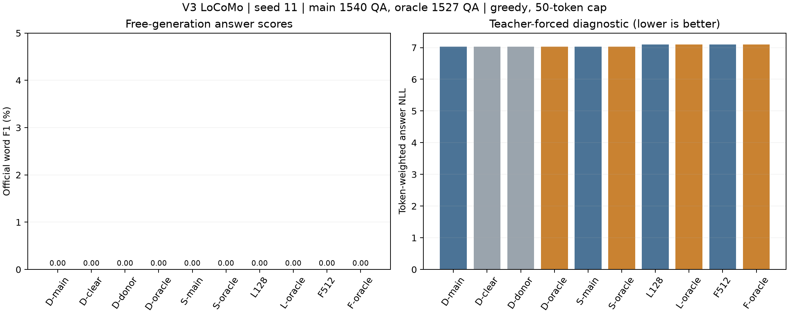

# V3 LoCoMo 冻结检查点评估：问答生成失败

2026-11-03。本轮10个条件全部完成，无训练、无调参。固定seed11，使用既有四个1024步末尾检查点，约33.3万参数；原生Mac MPS执行。全部19860条条件×问题记录已保存，其中18024条实际生成，其余1836条为oracle不适用记录。

## 结论

当前四个小模型均未形成可用的LoCoMo问答生成能力。完整历史、清空历史、无关历史与证据直给全部得到零F1。所有实际生成的答案都重复同一个词`the`，达到50个BPE token上限；没有一题获得正F1或归一化精确匹配。

证据直给条件也失败，使本轮无法进一步区分“信息没有保存”“问题没有检索到信息”和“读到了信息但无法组织答案”。首先需要建立可靠的基础问答阳性对照，然后才能归因记忆机制。当前检查点直接用于长对话记忆任务的方案没有跑通。

## 数据与固定协议

使用[官方LoCoMo固定提交](https://github.com/snap-research/locomo/tree/3eb6f2c585f5e1699204e3c3bdf7adc5c28cb376)，下载校验Git blob、长度与SHA256。10段对话共1986题；主分数为第1—4类1540题的官方词级F1，第5类446道对抗题单列。历史长度为本项目4096 BPE下20643—39046 token。输入包括原始日期、说话人、话轮及已有图像caption，未输入QA标注、生成摘要或观察。

每题从同一历史快照独立分支，使用训练时的Question/Answer格式。自由生成不输入参考答案，贪心解码，最多50个BPE token，遇EOS结束。另在独立状态分支计算参考答案NLL。既有SQuAD保留测试仍未评分；本次新增的是LoCoMo评估。

4题缺失证据、9题引用无效话轮：主评估保留全部1540题；证据直给评估1527题。Oracle中446道对抗题及13道证据问题标为not_applicable，每组459题，不按零分计入oracle均值。

## 实际分数

| 模型/干预 | 主评估F1 % | 证据直给F1 % | 主评估答案NLL↓ | 证据直给答案NLL↓ |
|---|---:|---:|---:|---:|
| V3动态Bio | 0.0000 | 0.0000 | 7.030887 | 7.032350 |
| V3静态地址Bio | 0.0000 | 0.0000 | 7.027584 | 7.029691 |
| Transformer，128窗口 | 0.0000 | 0.0000 | 7.100146 | 7.103214 |
| Transformer，512窗口 | 0.0000 | 0.0000 | 7.101419 | 7.096625 |
| 动态Bio，清空历史、保留时钟 | 0.0000 | — | 7.030944 | — |
| 动态Bio，无关对话、匹配历史token数 | 0.0000 | — | 7.030444 | — |

主评估与oracle题集大小不同；严格配对比较使用主组的1527题证据有效子集，详见[统计JSON](statistics.json)。上述NLL为teacher-forced逐答案token加权诊断，F1基于自由生成。

四模型及全部干预都只有一种生成答案，内容是50次`the`；达到长度上限比例100%。主组首token命中7/1540（0.45%），oracle为7/1527（0.46%）；这些偶然命中没有带来完整答案得分。官方归一化删除冠词，重复`the`的归一化答案为空；所有1540个参考答案归一化后非空。第1—4类分别为282、321、96、841题，全部零F1。原始问题提示下的对抗拒答率也为0%。

## 历史干预与概率差异

以下为动态主组减去对照的答案NLL，负数表示动态主组较低。区间通过10段对话聚类、20000次bootstrap得到，仅反映这一个检查点在对话样本上的变化。

| 对照 | NLL差 | 对话bootstrap 95%区间 |
|---|---:|---|
| 清空历史 | −0.000057 | [−0.003671, +0.004382] |
| 无关历史 | +0.000443 | [−0.000556, +0.001348] |
| 静态地址Bio | +0.003303 | [−0.000537, +0.007119] |
| Transformer 128 | −0.069259 | [−0.075804, −0.062746] |
| Transformer 512 | −0.070532 | [−0.079758, −0.062285] |

Bio对参考答案序列分配的概率略好于这两个Transformer对照，动态历史与地址更新没有建立稳定增量，所有实际答案依旧相同。清空/错换历史的细微NLL差异不足以支持成功检索。固定一训练种子的区间也不覆盖重训方差。

## 与上一轮结论的关系

上一轮三种子训练中，动态Bio的文本PPL较当前局部Transformer降低约16.3%，训练耗时约10.9倍。本轮独立生成检查进一步说明：该文本预测优势尚未转化为可用问答。四模型在给定证据后仍失败，当前规模和训练预算不足以承担这次复杂长对话任务。基础能力不足是由共同生成退化支持的解释；训练量、模型容量、训练任务与提示分布各自的贡献尚未单独测定。

当前最有价值的下一步是建立“给出证据能答对”的公开问答阳性对照，再逐步增加证据距离与干扰，配对检查状态清空、错换与动态地址。需要事先规定通过标准，再安排下一轮训练。本轮没有追加训练、换提示、改解码或挑选种子来改善分数。

## 执行与完整性

- 10/10条件completed；failed、aborted、not_executed均为0。Oracle不适用单独登记。
- 10项评估自检通过，涵盖官方评分一致性、CPU/MPS批量与逐题等价、不同块时钟、ragged KV、金答案隔离和数据校验。
- 58份冻结模型源码、10份评估源码与4个检查点文件哈希全部未变；10个条件的运行时参数摘要均通过前后比对。
- 逐题原始预测、参考答案、生成token、时延与状态保留本地。公开副本只提供数值投影、哈希、协议、分析和代码。
- 条件执行计时合计629.8秒，包含历史处理、自由生成与附加NLL；包含缓存复用，不能作为统一模型推理速度排名。Bio单条历史持久状态90120字节，128/512窗口KV分别114832/459280字节；这些数值未计模型权重与临时激活。

## 解释范围

这轮是一个训练种子、贪心解码的词级F1评估，与MemT使用LLM裁判的准确率口径不同。主组Transformer只保留训练时128/512窗口；完整LoCoMo可见的长上下文Transformer阳性对照未执行。为容纳全部选定证据，oracle Transformer扩展评测窗口至1772，属于超出训练窗口的诊断。Bio保持原配置。

当前结果明确否定了这批检查点已经具有实用长对话记忆问答能力的判断。架构在更充分训练后的表现仍待实验。

协议见[上级评估报告](../REPORT.md)、[协议JSON](../protocol.json)、[完整性审计](audit.json)与[评估器说明](../../../../evaluations/locomo/README.md)。

