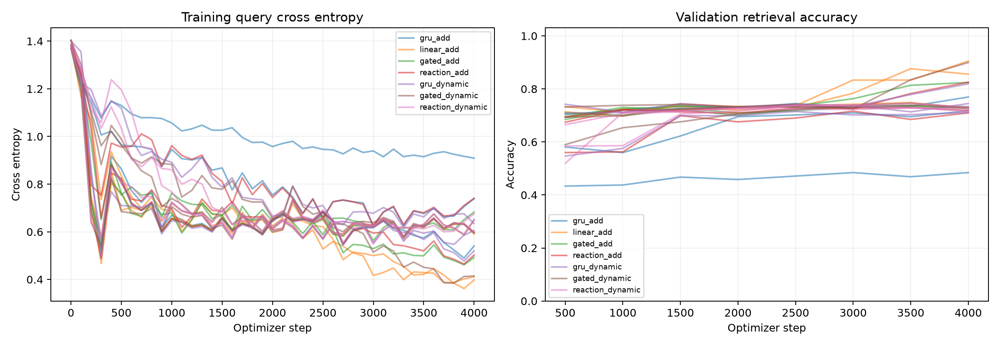

# Bio-Matrix 状态记忆实验

> 归档说明：本文保留写作时点的设计或状态。项目已停止v0.9后续训练；最新执行状态见[实验索引](../../docs/RESULTS_INDEX.md)。公开副本不含权重与语料。

状态：全部完成。

无 Attention、无 KV Cache、无查询阶段的写入历史。所有模型只依靠显式递推状态。

主指标预先固定为 two_delay24 和 four_delay24 的准确率与交叉熵等权平均。正式模型均训练相同事件序列与步数，状态容量相同；参数和实际计算量不完全相同。

| 模型 | 种子数 | 参数 | 持久状态浮点数 | 主准确率（均值 ± SD） | 主 CE | 清零准确率 | 交换准确率 | 优化秒/次 | 事件/秒 |
|---|---:|---:|---:|---:|---:|---:|---:|---:|---:|
| gru_add | 3 | 11,716 | 32 | 53.7% ± 6.5% | 0.7720 | 24.8% | 23.9% | 27.06 | 152,504 |
| linear_add | 3 | 7,492 | 32 | 74.3% ± 17.2% | 0.5254 | 24.6% | 23.0% | 19.09 | 216,177 |
| gated_add | 3 | 9,540 | 32 | 59.9% ± 8.5% | 0.6960 | 25.2% | 22.8% | 23.60 | 174,853 |
| reaction_add | 3 | 10,308 | 32 | 61.5% ± 12.3% | 0.6953 | 24.7% | 23.3% | 33.16 | 124,613 |
| gru_dynamic | 3 | 11,716 | 32 | 61.1% ± 10.5% | 0.6680 | 25.6% | 24.6% | 27.22 | 151,592 |
| gated_dynamic | 3 | 9,540 | 32 | 66.6% ± 18.1% | 0.6245 | 24.0% | 22.2% | 23.63 | 174,911 |
| reaction_dynamic | 3 | 10,308 | 32 | 54.8% ± 0.6% | 0.7584 | 24.9% | 22.0% | 32.12 | 128,592 |

## 配对消融

| 比较（前者减后者） | 主准确率差（百分点） | 每个种子的差值 |
|---|---:|---|
| gated_add − linear_add | -14.42 | +0.49, -32.32, -11.43 |
| reaction_add − gated_add | +1.66 | -0.88, -0.29, +6.15 |
| reaction_dynamic − gated_dynamic | -11.78 | -1.95, -33.30, -0.10 |
| gru_dynamic − gru_add | +7.36 | +3.81, +6.45, +11.82 |
| reaction_dynamic − reaction_add | -6.71 | +0.68, -0.29, -20.51 |
| reaction_dynamic − gru_dynamic | -6.25 | +4.10, -6.35, -16.50 |

## 完整难度结果

| 模型 | 条件 | 保留准确率 | 清零准确率 | 交换准确率 | 保留 CE |
|---|---|---:|---:|---:|---:|
| gru_add | one_short | 84.0% | 24.0% | 27.1% | 0.2930 |
| gru_add | two_short | 63.7% | 24.3% | 24.7% | 0.5935 |
| gru_add | four_short | 45.6% | 25.9% | 23.3% | 0.9383 |
| gru_add | two_delay24 | 62.1% | 24.9% | 24.7% | 0.6073 |
| gru_add | four_delay24 | 45.3% | 24.7% | 23.1% | 0.9366 |
| gru_add | two_delay64 | 58.9% | 23.7% | 24.7% | 0.7306 |
| gru_add | four_delay128 | 45.8% | 23.8% | 27.8% | 1.0751 |
| gru_add | six_pairs | 39.1% | 24.2% | 24.7% | 1.0968 |
| gru_add | eight_pairs | 36.8% | 24.8% | 24.8% | 1.1854 |
| gru_add | overwrite | 47.6% | 23.3% | 24.3% | 0.9407 |
| gru_add | multi_query | 53.9% | 23.6% | 23.9% | 0.8014 |
| linear_add | one_short | 100.0% | 26.3% | 25.8% | 0.0095 |
| linear_add | two_short | 84.8% | 23.6% | 24.5% | 0.3147 |
| linear_add | four_short | 66.1% | 26.5% | 25.6% | 0.7123 |
| linear_add | two_delay24 | 83.8% | 24.7% | 24.5% | 0.3225 |
| linear_add | four_delay24 | 64.8% | 24.5% | 21.6% | 0.7283 |
| linear_add | two_delay64 | 77.3% | 24.5% | 22.3% | 0.3634 |
| linear_add | four_delay128 | 50.6% | 25.0% | 26.8% | 1.0549 |
| linear_add | six_pairs | 51.4% | 25.1% | 24.1% | 0.9526 |
| linear_add | eight_pairs | 44.9% | 23.4% | 23.4% | 1.0750 |
| linear_add | overwrite | 66.0% | 23.6% | 25.1% | 0.7172 |
| linear_add | multi_query | 71.4% | 24.2% | 24.1% | 0.5616 |
| gated_add | one_short | 100.0% | 23.1% | 25.8% | 0.0192 |
| gated_add | two_short | 68.1% | 24.1% | 24.8% | 0.4871 |
| gated_add | four_short | 53.7% | 25.2% | 25.5% | 0.8863 |
| gated_add | two_delay24 | 67.9% | 24.0% | 24.1% | 0.4864 |
| gated_add | four_delay24 | 51.8% | 26.4% | 21.5% | 0.9055 |
| gated_add | two_delay64 | 69.2% | 24.4% | 22.1% | 0.5039 |
| gated_add | four_delay128 | 51.9% | 23.4% | 28.3% | 0.9524 |
| gated_add | six_pairs | 40.2% | 25.1% | 24.4% | 1.1053 |
| gated_add | eight_pairs | 38.9% | 24.8% | 23.0% | 1.2120 |
| gated_add | overwrite | 55.7% | 25.0% | 24.2% | 0.8643 |
| gated_add | multi_query | 60.5% | 24.0% | 24.8% | 0.7040 |
| reaction_add | one_short | 100.0% | 23.6% | 25.8% | 0.0357 |
| reaction_add | two_short | 71.2% | 24.5% | 24.3% | 0.4851 |
| reaction_add | four_short | 51.5% | 24.7% | 25.9% | 0.9021 |
| reaction_add | two_delay24 | 70.2% | 24.0% | 24.4% | 0.4865 |
| reaction_add | four_delay24 | 52.9% | 25.5% | 22.3% | 0.9041 |
| reaction_add | two_delay64 | 68.6% | 24.5% | 23.2% | 0.5251 |
| reaction_add | four_delay128 | 50.9% | 24.7% | 26.4% | 0.9605 |
| reaction_add | six_pairs | 40.0% | 25.3% | 26.4% | 1.1264 |
| reaction_add | eight_pairs | 35.9% | 25.8% | 23.8% | 1.2600 |
| reaction_add | overwrite | 54.0% | 24.4% | 23.4% | 0.8919 |
| reaction_add | multi_query | 61.1% | 25.3% | 24.2% | 0.7142 |
| gru_dynamic | one_short | 100.0% | 26.6% | 25.5% | 0.0070 |
| gru_dynamic | two_short | 72.2% | 26.1% | 24.2% | 0.4422 |
| gru_dynamic | four_short | 53.1% | 24.3% | 25.2% | 0.8645 |
| gru_dynamic | two_delay24 | 70.5% | 24.9% | 24.6% | 0.4486 |
| gru_dynamic | four_delay24 | 51.6% | 26.4% | 24.7% | 0.8874 |
| gru_dynamic | two_delay64 | 69.7% | 24.3% | 24.0% | 0.5017 |
| gru_dynamic | four_delay128 | 49.7% | 24.4% | 27.9% | 0.9573 |
| gru_dynamic | six_pairs | 41.8% | 25.5% | 23.8% | 1.0930 |
| gru_dynamic | eight_pairs | 38.4% | 23.1% | 21.4% | 1.2495 |
| gru_dynamic | overwrite | 53.5% | 25.5% | 23.8% | 0.8631 |
| gru_dynamic | multi_query | 59.7% | 25.4% | 25.0% | 0.6909 |
| gated_dynamic | one_short | 100.0% | 26.4% | 25.9% | 0.0049 |
| gated_dynamic | two_short | 72.7% | 23.3% | 23.7% | 0.4225 |
| gated_dynamic | four_short | 59.6% | 25.3% | 24.8% | 0.8154 |
| gated_dynamic | two_delay24 | 74.3% | 23.0% | 23.0% | 0.4285 |
| gated_dynamic | four_delay24 | 58.9% | 25.0% | 21.4% | 0.8204 |
| gated_dynamic | two_delay64 | 70.9% | 25.9% | 23.8% | 0.4682 |
| gated_dynamic | four_delay128 | 53.1% | 24.3% | 27.1% | 0.9431 |
| gated_dynamic | six_pairs | 47.2% | 24.7% | 25.2% | 1.0389 |
| gated_dynamic | eight_pairs | 44.3% | 23.6% | 23.3% | 1.1692 |
| gated_dynamic | overwrite | 58.8% | 23.2% | 24.5% | 0.8281 |
| gated_dynamic | multi_query | 65.6% | 23.9% | 24.6% | 0.6449 |
| reaction_dynamic | one_short | 100.0% | 25.5% | 25.8% | 0.0016 |
| reaction_dynamic | two_short | 63.4% | 24.9% | 23.9% | 0.5395 |
| reaction_dynamic | four_short | 52.6% | 24.9% | 25.4% | 0.9381 |
| reaction_dynamic | two_delay24 | 61.2% | 24.3% | 23.2% | 0.5524 |
| reaction_dynamic | four_delay24 | 48.4% | 25.5% | 20.8% | 0.9644 |
| reaction_dynamic | two_delay64 | 60.6% | 25.1% | 24.0% | 0.8420 |
| reaction_dynamic | four_delay128 | 50.0% | 24.3% | 27.1% | 1.0238 |
| reaction_dynamic | six_pairs | 40.4% | 25.2% | 25.9% | 1.1632 |
| reaction_dynamic | eight_pairs | 41.5% | 23.9% | 24.5% | 1.2559 |
| reaction_dynamic | overwrite | 53.3% | 25.5% | 23.6% | 0.9228 |
| reaction_dynamic | multi_query | 57.3% | 24.9% | 24.6% | 0.7638 |

## 工程成本

| 模型 | CPU 进程峰值 RSS GB | 采样 Metal 驱动 GB | 非查询事件稠密 MAC 估计 |
|---|---:|---:|---:|
| gru_add | 0.590 | 0.067 | 7,168 |
| linear_add | 0.587 | 0.028 | 3,072 |
| gated_add | 0.589 | 0.028 | 5,120 |
| reaction_add | 0.595 | 0.028 | 5,888 |
| gru_dynamic | 0.590 | 0.070 | 7,168 |
| gated_dynamic | 0.589 | 0.028 | 5,120 |
| reaction_dynamic | 0.593 | 0.028 | 5,888 |

MAC 只估计稠密线性运算，未包括查询读出、激活、优化器和反向传播，不作为完整 FLOPs。Metal 数值为驱动分配量采样，RSS 为独立训练进程的峰值；二者不能相加当作统一内存峰值。优化秒不含数据生成、验证、保存和测试；分批评测的状态交换只在当前批内滚动。

## 解释边界

四种值的理论机会准确率为 25%。正式比较有三个种子；标准差描述种子波动，不等于置信区间或统计显著性。所有预设条件和种子均报告，没有按照测试分数挑选模型。

主测试处于训练过的难度范围；64/128 延迟和6/8键属于外推。多查询的4次查询超过训练时最多2次。输入为中文符号编码的合成事件，并非自然中文语言理解任务。

这些实验验证特定状态单元与读出方式，不能外推为真实生物机制、持续学习或通用大模型优势。

状态干预（本地留存：`interventions.png`）
