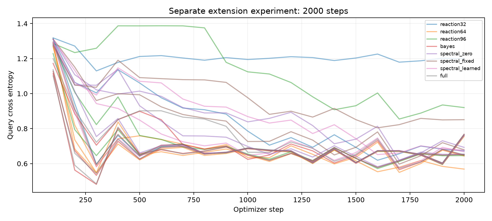

# 概率与频率扩展：全部难度和状态干预

> 归档说明：本文保留写作时点的设计或状态。项目已停止v0.9后续训练；最新执行状态见[实验索引](../../docs/RESULTS_INDEX.md)。公开副本不含权重与语料。

| 模型 | 条件 | 保留准确率 | 清零准确率 | 交换准确率 | 保留CE |
|---|---|---:|---:|---:|---:|
| reaction32 | one_short | 83.2% | 24.2% | 24.6% | 0.3469 |
| reaction32 | two_short | 59.0% | 24.3% | 27.2% | 0.7242 |
| reaction32 | four_short | 47.7% | 24.6% | 26.3% | 1.0861 |
| reaction32 | two_delay24 | 60.7% | 24.2% | 24.9% | 0.7242 |
| reaction32 | four_delay24 | 48.6% | 26.2% | 23.4% | 1.0336 |
| reaction32 | two_delay64 | 54.7% | 25.7% | 27.6% | 0.7632 |
| reaction32 | four_delay128 | 42.3% | 24.6% | 23.8% | 1.1263 |
| reaction32 | six_pairs | 43.2% | 26.3% | 25.8% | 1.1652 |
| reaction32 | eight_pairs | 39.2% | 23.6% | 25.5% | 1.2981 |
| reaction32 | overwrite | 45.8% | 27.0% | 28.4% | 1.0624 |
| reaction32 | multi_query | 51.6% | 24.9% | 22.9% | 0.9201 |
| reaction32 | noisy_p00 | 59.4% | 24.6% | 30.1% | 0.7078 |
| reaction32 | noisy_p20 | 54.6% | 24.6% | 30.3% | 0.9026 |
| reaction32 | noisy_p35 | 46.7% | 24.6% | 27.0% | 1.1325 |
| reaction32 | noisy_repeat5 | 54.7% | 25.0% | 25.9% | 0.8871 |
| reaction64 | one_short | 100.0% | 22.1% | 23.8% | 0.0066 |
| reaction64 | two_short | 66.3% | 25.1% | 26.7% | 0.4716 |
| reaction64 | four_short | 52.7% | 24.9% | 26.2% | 0.9216 |
| reaction64 | two_delay24 | 68.1% | 26.6% | 25.7% | 0.4726 |
| reaction64 | four_delay24 | 55.5% | 23.6% | 22.0% | 0.8786 |
| reaction64 | two_delay64 | 61.8% | 27.5% | 26.4% | 0.6317 |
| reaction64 | four_delay128 | 47.7% | 21.7% | 24.5% | 1.0206 |
| reaction64 | six_pairs | 45.2% | 26.6% | 24.6% | 1.0504 |
| reaction64 | eight_pairs | 41.9% | 29.3% | 23.8% | 1.2110 |
| reaction64 | overwrite | 54.8% | 23.0% | 28.9% | 0.8911 |
| reaction64 | multi_query | 57.7% | 26.0% | 22.5% | 0.7236 |
| reaction64 | noisy_p00 | 68.4% | 26.2% | 29.9% | 0.4594 |
| reaction64 | noisy_p20 | 64.3% | 26.2% | 30.7% | 0.6967 |
| reaction64 | noisy_p35 | 54.7% | 26.2% | 28.0% | 1.0370 |
| reaction64 | noisy_repeat5 | 68.2% | 25.3% | 25.0% | 0.6272 |
| reaction96 | one_short | 91.7% | 22.1% | 24.6% | 0.1342 |
| reaction96 | two_short | 62.2% | 25.1% | 27.0% | 0.6503 |
| reaction96 | four_short | 49.6% | 24.9% | 26.3% | 1.0295 |
| reaction96 | two_delay24 | 65.5% | 26.6% | 25.3% | 0.6273 |
| reaction96 | four_delay24 | 51.2% | 23.6% | 25.0% | 0.9840 |
| reaction96 | two_delay64 | 57.8% | 27.5% | 28.0% | 0.6824 |
| reaction96 | four_delay128 | 46.0% | 21.7% | 25.1% | 1.0668 |
| reaction96 | six_pairs | 46.4% | 26.6% | 26.2% | 1.1181 |
| reaction96 | eight_pairs | 39.6% | 29.3% | 25.0% | 1.2647 |
| reaction96 | overwrite | 48.7% | 23.0% | 30.5% | 1.0082 |
| reaction96 | multi_query | 53.9% | 26.0% | 23.0% | 0.8618 |
| reaction96 | noisy_p00 | 63.8% | 26.2% | 30.3% | 0.6216 |
| reaction96 | noisy_p20 | 58.1% | 26.2% | 29.7% | 0.8092 |
| reaction96 | noisy_p35 | 50.5% | 26.2% | 26.6% | 1.0919 |
| reaction96 | noisy_repeat5 | 61.2% | 25.3% | 26.8% | 0.7554 |
| bayes | one_short | 100.0% | 27.6% | 23.8% | 0.0040 |
| bayes | two_short | 64.6% | 24.7% | 25.8% | 0.5071 |
| bayes | four_short | 52.6% | 24.6% | 25.4% | 0.9717 |
| bayes | two_delay24 | 68.2% | 25.0% | 24.6% | 0.5088 |
| bayes | four_delay24 | 54.4% | 27.0% | 23.8% | 0.9185 |
| bayes | two_delay64 | 60.4% | 23.0% | 26.7% | 0.5435 |
| bayes | four_delay128 | 48.6% | 26.8% | 25.5% | 0.9866 |
| bayes | six_pairs | 48.6% | 23.2% | 23.0% | 1.0655 |
| bayes | eight_pairs | 42.7% | 23.7% | 23.8% | 1.2615 |
| bayes | overwrite | 52.5% | 24.9% | 30.5% | 0.9413 |
| bayes | multi_query | 57.4% | 24.6% | 22.6% | 0.7644 |
| bayes | noisy_p00 | 66.7% | 26.4% | 29.6% | 0.4967 |
| bayes | noisy_p20 | 65.1% | 26.4% | 31.2% | 0.7191 |
| bayes | noisy_p35 | 56.0% | 26.4% | 27.9% | 1.0121 |
| bayes | noisy_repeat5 | 65.2% | 28.0% | 26.3% | 0.6488 |
| spectral_zero | one_short | 100.0% | 21.6% | 23.8% | 0.0070 |
| spectral_zero | two_short | 64.3% | 24.3% | 26.8% | 0.5291 |
| spectral_zero | four_short | 53.3% | 23.4% | 23.6% | 0.9808 |
| spectral_zero | two_delay24 | 67.3% | 26.6% | 24.6% | 0.5237 |
| spectral_zero | four_delay24 | 52.2% | 23.7% | 24.0% | 0.9351 |
| spectral_zero | two_delay64 | 61.3% | 29.0% | 29.6% | 0.6922 |
| spectral_zero | four_delay128 | 43.1% | 21.7% | 24.7% | 1.5564 |
| spectral_zero | six_pairs | 47.8% | 27.0% | 22.8% | 1.0864 |
| spectral_zero | eight_pairs | 41.0% | 29.8% | 23.7% | 1.2453 |
| spectral_zero | overwrite | 52.0% | 24.1% | 29.7% | 0.9459 |
| spectral_zero | multi_query | 57.4% | 24.9% | 22.5% | 0.7836 |
| spectral_zero | noisy_p00 | 65.0% | 25.1% | 29.4% | 0.5098 |
| spectral_zero | noisy_p20 | 62.4% | 25.1% | 31.8% | 0.7511 |
| spectral_zero | noisy_p35 | 53.5% | 25.1% | 28.4% | 1.0440 |
| spectral_zero | noisy_repeat5 | 63.5% | 24.1% | 26.4% | 0.7083 |
| spectral_fixed | one_short | 90.6% | 22.9% | 23.7% | 0.1306 |
| spectral_fixed | two_short | 64.2% | 26.0% | 28.3% | 0.5958 |
| spectral_fixed | four_short | 49.5% | 26.0% | 25.9% | 1.0273 |
| spectral_fixed | two_delay24 | 65.0% | 24.2% | 26.2% | 0.5833 |
| spectral_fixed | four_delay24 | 49.3% | 22.7% | 23.4% | 0.9785 |
| spectral_fixed | two_delay64 | 57.4% | 25.7% | 26.6% | 0.6966 |
| spectral_fixed | four_delay128 | 45.7% | 23.7% | 26.3% | 1.2312 |
| spectral_fixed | six_pairs | 44.4% | 25.5% | 23.8% | 1.1268 |
| spectral_fixed | eight_pairs | 41.7% | 25.9% | 24.7% | 1.2507 |
| spectral_fixed | overwrite | 48.7% | 26.8% | 29.4% | 1.0015 |
| spectral_fixed | multi_query | 55.3% | 24.8% | 21.9% | 0.8246 |
| spectral_fixed | noisy_p00 | 65.0% | 23.2% | 29.9% | 0.5657 |
| spectral_fixed | noisy_p20 | 61.1% | 23.2% | 30.5% | 0.8225 |
| spectral_fixed | noisy_p35 | 52.0% | 23.2% | 27.7% | 1.0848 |
| spectral_fixed | noisy_repeat5 | 57.9% | 22.4% | 26.0% | 0.7920 |
| spectral_learned | one_short | 100.0% | 24.2% | 23.8% | 0.0086 |
| spectral_learned | two_short | 66.4% | 24.3% | 26.4% | 0.5128 |
| spectral_learned | four_short | 50.4% | 24.6% | 25.5% | 0.9925 |
| spectral_learned | two_delay24 | 70.3% | 24.2% | 24.7% | 0.5097 |
| spectral_learned | four_delay24 | 52.3% | 26.2% | 22.1% | 0.9199 |
| spectral_learned | two_delay64 | 62.0% | 25.7% | 24.9% | 0.6608 |
| spectral_learned | four_delay128 | 46.7% | 24.6% | 24.6% | 1.2324 |
| spectral_learned | six_pairs | 46.5% | 26.3% | 25.9% | 1.0913 |
| spectral_learned | eight_pairs | 40.0% | 23.6% | 25.9% | 1.2797 |
| spectral_learned | overwrite | 51.0% | 27.0% | 29.9% | 0.9509 |
| spectral_learned | multi_query | 57.2% | 24.9% | 22.4% | 0.7755 |
| spectral_learned | noisy_p00 | 68.0% | 24.6% | 29.3% | 0.4981 |
| spectral_learned | noisy_p20 | 64.2% | 24.6% | 31.1% | 0.7417 |
| spectral_learned | noisy_p35 | 55.3% | 24.6% | 27.9% | 1.0337 |
| spectral_learned | noisy_repeat5 | 66.5% | 25.0% | 25.8% | 0.6951 |
| full | one_short | 100.0% | 26.0% | 23.8% | 0.0027 |
| full | two_short | 64.5% | 24.9% | 27.2% | 0.5106 |
| full | four_short | 51.7% | 25.5% | 24.9% | 0.9689 |
| full | two_delay24 | 65.1% | 22.7% | 24.2% | 0.5173 |
| full | four_delay24 | 53.9% | 25.9% | 23.2% | 0.9204 |
| full | two_delay64 | 62.9% | 23.7% | 27.2% | 0.5423 |
| full | four_delay128 | 48.3% | 27.2% | 24.9% | 0.9914 |
| full | six_pairs | 48.8% | 24.7% | 23.0% | 1.0647 |
| full | eight_pairs | 42.1% | 20.6% | 23.4% | 1.2731 |
| full | overwrite | 52.1% | 28.1% | 30.9% | 0.9349 |
| full | multi_query | 56.9% | 24.2% | 23.3% | 0.7643 |
| full | noisy_p00 | 65.9% | 23.2% | 30.5% | 0.4981 |
| full | noisy_p20 | 64.6% | 23.2% | 31.5% | 0.7247 |
| full | noisy_p35 | 55.6% | 23.2% | 28.4% | 1.0236 |
| full | noisy_repeat5 | 64.1% | 23.3% | 25.8% | 0.6549 |

