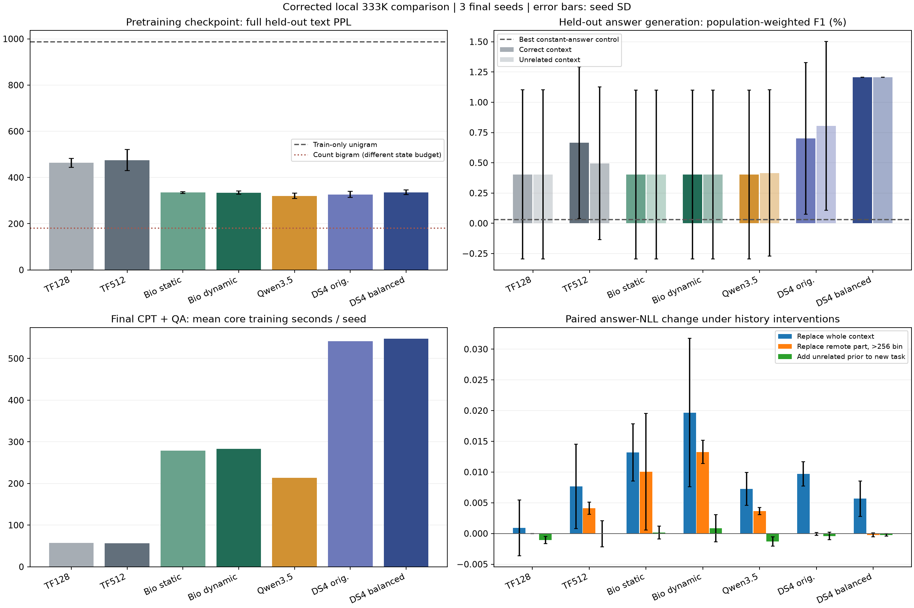
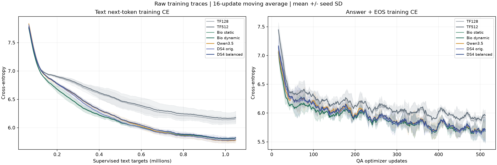
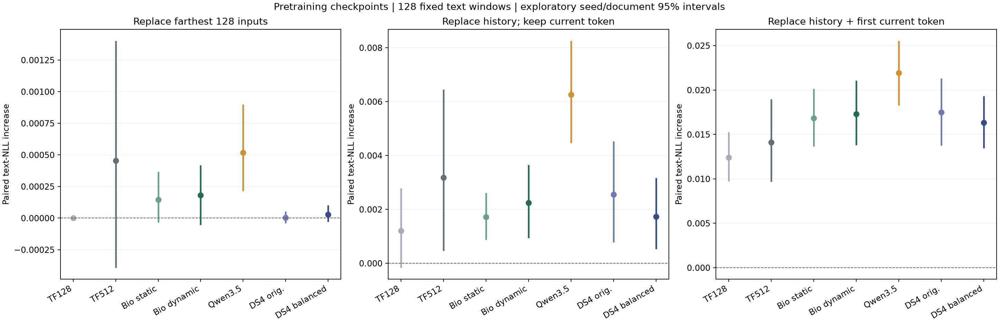

# 修正版本地微型架构对比

本轮冻结协议：7个预先指定配置；各阶段3个学习率候选；搜索种子101；最终种子11/23/37。所有最终配置训练完成后才评分保留测试。原实验独立保留。

## 保留测试：三种子均值

| 配置 | 参数 | 预训练PPL↓ | 问答后PPL↓ | 首答案命中↑ | 生成EM↑ | 生成F1↑ | 核心训练秒/种子 |
|---|---:|---:|---:|---:|---:|---:|---:|
| trans_local | 333,106 | 463.24 | 1458.81 | 4.47% | 0.23% | 0.40% | 57.4 |
| trans_full | 333,106 | 475.47 | 1496.25 | 4.47% | 0.23% | 0.67% | 56.9 |
| v3_static | 333,136 | 335.04 | 1162.61 | 4.47% | 0.23% | 0.40% | 279.2 |
| v3_dynamic | 333,136 | 334.44 | 1175.35 | 4.46% | 0.23% | 0.40% | 283.1 |
| qwen35_tiny | 332,950 | 320.46 | 1205.73 | 4.47% | 0.23% | 0.40% | 213.6 |
| deepseek4_tiny | 333,065 | 326.90 | 1109.28 | 4.41% | 0.47% | 0.70% | 541.8 |
| deepseek4_balanced | 333,243 | 335.93 | 1166.42 | 4.47% | 0.70% | 1.21% | 547.3 |

文本覆盖WikiText保留测试的全部非BOS目标，每个位置评分一次；每段最多256个前置token，接着评分最多256个新目标。问答teacher forcing覆盖全部合格官方SQuAD dev题；生成按证据距离三桶各64题，表中EM/F1按各桶总体题数加权。原始逐题生成保存在本地private文件，公开数值投影不含题目、答案或预测原文。

## 学习链路和历史证据

8道真实短问答的固定预算过拟合检查通过情况：`{"trans_local": true, "trans_full": true, "v3_static": true, "v3_dynamic": true, "qwen35_tiny": true, "deepseek4_tiny": true, "deepseek4_balanced": true}`。阈值为答案NLL<0.5、首答案准确率≥87.5%、训练题生成EM≥50%；此项仅检验学习链路。

summary.json给出每个种子的无关上下文替换、远处上下文替换及独立新任务前插入无关历史的答案NLL效应，并列出无关上下文生成F1。正确使用证据须同时检查生成表现与配对干预，不能仅依据训练损失或单个平均NLL。

## 范围与统计

主文本比较使用问答后训前的检查点；后训PPL单独衡量语言建模退化。Bio动态与静态对照用于检验动态地址的额外作用。DeepSeek原配置和均衡配置分别报告，不做家族内部择优后冒充相同搜索预算。

summary.json保存20000次配对种子/文章交叉bootstrap，含95%区间及六个对比的Bonferroni名义调整区间。区间受三个已观察种子和当前任务限制，未覆盖完整超参数搜索方差。

同目标词频控制的保留测试PPL：`{"11": 986.5708066417302, "23": 987.0166049863187, "37": 985.944503765802}`。各模型损失都使用同一新BPE；与其他分词口径的论文PPL不能直接比较。不同结构的FLOPs、运行态、原生初始化与实现效率不同；本轮时间仅代表Mac MPS参考实现。

学习率选择见selection.json；完整协议、逐更新日志、阶段检查点、开发评分及保留测试均在本目录。失败/中止/未执行条件分别记在registry.json和heldout/registry.json。原始实验结果不覆盖。

## 完成后的结果解读（2026-11-03）

全部91个训练阶段和21个保留测试模型均为completed；答案先验、二元计数、文本历史干预与图表四项后处理均完成。原实验281个文件的哈希保持一致，补充分析前后42份最终检查点和71份冻结源码保持一致；训练后再次校验13份准备数据及manifest，均符合冻结协议。初始专家宽度19的原生矩阵对齐验收失败单独保留在[开发验收记录](development_preflight_history.json)，正式训练采用验收通过后的配置。

1. **Bio在当前预算下能学习语言统计，动态地址的额外收益接近零。** 动态预训练PPL为334.44，静态335.04；静态减动态的NLL差为0.001883，六对比调整区间[-0.007612, 0.011276]，包含0。两组均保留随历史写入的value；差别是序列内key/相位地址是否更新。问答后静态PPL还略好于动态（1162.61对1175.35），对应调整NLL区间[-0.020347, -0.002765]。
2. **本轮支持Bio相对朴素Transformer配置的短预算文本优势，Qwen/DeepSeek的旧排名已经改变。** Transformer128/512的预训练PPL为463.24/475.47；Qwen为320.46，DeepSeek原配置326.90，均衡配置335.93。Qwen和DeepSeek原配置点估计优于Bio动态，二者相对Bio的调整NLL区间分别为[-0.107436, 0.010409]与[-0.055069, 0.009482]，仍包含0。当前样本没有稳定分离这三种配置的总体排名。
3. **公开问答在这套训练预算下没有学成有效检索。** Bio静态/动态的生成F1均为0.4026%，EM均为0.2331%；三种子中仅seed11在相同一道抽样题上命中。动态版各自最常见答案在192题中出现190、177、183次，总体加权占比三种子平均96.59%。两种Bio的正常/无关上下文F1均完全相同；teacher-forcing NLL虽然会变化，实际正确作答没有相应收益。DeepSeek均衡配置F1为1.2077%，其最常见答案占比平均98.79%，也存在强烈坍缩。
4. **先验与生成稳定性问题仍在。** 训练集最常见首答案token在全量保留测试准确率为4.4660%，七种配置的首答案准确率约4.41%—4.47%，接近该控制。固定训练答案控制在192题样本上的加权F1为0.0312%，全量10121题F1为0.5465%；稀有答案的生成样本估计波动较大，约1%的模型F1差异不作稳定能力排序。Qwen seed37触顶率为97.75%，Transformer128 seed23/37为99.83%/66.63%，DeepSeek原配置seed37为13.72%（均为总体加权）；Bio两组与均衡DeepSeek三种子均未触顶。八题过拟合EM100%确认学习链路可工作，复杂任务泛化和自由生成仍不稳定。
5. **问答后训显著破坏一般语言建模。** 七组问答后PPL均升至1109—1496，Transformer128为1458.81；纯预训练PPL为320—475。单词频控制PPL约986.51，七组问答后结果均更差。生成失败与遗忘共同说明当前后训配方需要重做；把原因单独归到架构或参数量都超出了本轮隔离范围。

## 文本历史的实际作用

在60个文档的128个固定窗口上，保留当前输入token和全部评分目标，只替换更早383个输入；仅看上一token的预测器在该条件下严格不变。下表为干预后NLL增加及探索性种子/文档95%区间，较早的首目标也单独保留。

| 配置 | 保留当前token：128目标均值ΔNLL及区间 | 同条件首目标ΔNLL及区间 | 仅替换最远128输入：均值ΔNLL及区间 |
|---|---|---|---|
| Bio静态 | 0.001720 [0.000871, 0.002621] | 0.003828 [-0.012396, 0.019254] | 0.000146 [-0.000034, 0.000368] |
| Bio动态 | 0.002246 [0.000945, 0.003656] | 0.007344 [-0.008253, 0.021919] | 0.000181 [-0.000053, 0.000418] |
| Qwen3.5微型 | 0.006256 [0.004462, 0.008256] | 0.254209 [0.136516, 0.376410] | 0.000517 [0.000216, 0.000901] |
| Transformer512 | 0.003179 [0.000459, 0.006450] | -0.003444 [-0.015594, 0.008904] | 0.000456 [-0.000392, 0.001402] |

Bio动态在完整128目标上平均增加0.002246，前32目标平均增加0.005627，两个探索性区间均为正：历史确实对这一小段文本预测有可测作用。首个续写目标效应为0.007344，区间跨0；最远128输入效应只有0.000181，区间同样跨0。当前没有清楚的远距离收益。Qwen在保留当前token的首目标上增加0.254209，区间[0.136516, 0.376410]，在本次探针上呈现更强历史条件依赖；这是干预读数，未另作跨架构效应差的正式检验。

如果连当前输入token一起替换，Bio动态首目标NLL会增加1.930588；该大效应主要涉及直接相邻输入，单凭这种替换容易夸大较早历史的作用。Transformer128的最远128输入效应严格为0，符合其两层局部感受野的预期，单token自检也通过。[完整历史诊断](lm_history_controls.json)保留所有配置、三种干预、首目标/前32/全128读数及逐位置结果。

同样的1M训练转移拟合的二元计数模型，保留测试PPL为180.42。其稠密计数表占64MiB，状态/参数预算不同；它作为局部转移学习的参考单独列出，不加入等参数神经模型排名。文本历史实验中的“保留当前token”条件也避免了把二元依赖直接算成较早历史效应。

## 成本、训练曝光与剩余边界

- 动态Bio每种子预训练+问答的核心更新平均283.06秒，静态279.16秒，Transformer512为56.90秒，Qwen213.58秒；动态相对Transformer约4.97倍，相对Qwen约1.33倍。全部91阶段共22,400次更新，核心训练合计7,024.12秒（含过拟合诊断和学习率搜索）；开发验证和测试另计。详见[分模型成本](analysis/compute_budget.json)及[全阶段成本](analysis/final_review.json)。Mac MPS参考实现的计时与旗舰CUDA算子分别解读。
- 每个正式模型1,048,576个文本目标、4096次问答抽样；独立文本位置约覆盖train的28.6%—28.9%，独立问答3980—4003题，约占train的5%。[曝光记录](analysis/training_exposure.json)保留每种子的计数与原轨迹哈希。
- 所有配置两阶段均选中上沿学习率0.003。搜索预训练64步、问答64步，最终预训练256步、问答512步；短程选择、窄网格与更长最终日程的适配尚未优化，区间也不覆盖搜索方差。已有最优点不能当作各架构的充分调优水平。
- 新BPE、数据筛选与覆盖评分改变了旧轮口径；各轮优先看内部配对。当前语料和任务仍单一，512上下文内按样本重置，长期连续会话、自动固化与大规模协作没有在此轮验证；0.133B/10B-token训练和CUDA测试保持未启动。
- 所有声明的正式条件已执行；原始失败/中止/未执行历史保持原样。原始语料、逐题预测、答案、模型与优化器检查点留在本地。公开全量问答数值按文章聚合，192题生成和干预保留逐题数值投影及预测哈希。

## 可复核文件与图

[执行状态](registry.json)、[保留测试状态](heldout/registry.json)、[主要统计](summary.json)、[答案先验](qa_prior_controls.json)、[二元计数](bigram_control.json)、[历史干预](lm_history_controls.json)、[权重/源码完整性](analysis_checkpoint_integrity.json)、[原实验保留核验](historical_preservation_after.json)、[完成后数据校验](data_integrity_after.json)、[最终审阅与全阶段成本](analysis/final_review.json)。

[输出坍缩审计](analysis/generation_dependence.json)及[脚本](analysis/generation_dependence.py)为看到首种子结果后新增的事后描述性分析：全21模型均报告，读取已有输出，未参与学习率、模型、检查点或主要指标选择。原始字符串仅用于本地规范化计数，公开哈希与计数。

运行中的电脑曾在17:48—18:17休眠，后续用绑定分析进程的caffeinate防止空闲睡眠；[执行环境记录](analysis/execution_environment_notes.json)保存该情况。核心训练计时全部早于这段休眠，评估墙钟不作为推理吞吐指标。

冻结查看器有一项显示问题：已完成条件登记不再携带ce，查看器会显示默认0。真实末步损失和曲线来自各目录metrics.jsonl；这些默认显示值不进入训练或统计。保留本轮冻结源码，显示修订另行处理。
