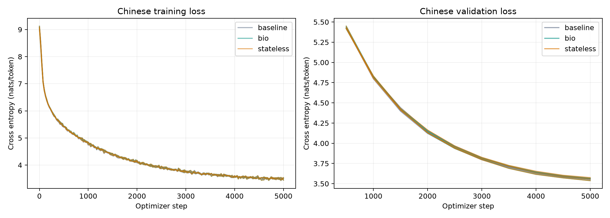

# 中文 Bio-LLM 实测结果

> 归档说明：本文保留写作时点的设计或状态。项目已停止v0.9后续训练；最新执行状态见[实验索引](../docs/RESULTS_INDEX.md)。公开副本不含权重与语料。

实验状态：全部完成。

同规模、同数据、同训练步数；计算成本单独报告。测试交叉熵为 nats/token，越低越好。

| 模型 | 完成种子数 | 参数量 | 测试交叉熵（均值 ± 标准差） | 困惑度均值 | 训练速度 Token/s | 训练分钟/次 | 采样 Metal GB |
|---|---:|---:|---:|---:|---:|---:|---:|
| baseline | 3 | 5,329,408 | 3.5129 ± 0.0053 | 33.54 | 14,231 | 11.97 | 1.60 |
| bio | 3 | 5,329,408 | 3.5111 ± 0.0180 | 33.49 | 7,678 | 21.99 | 2.83 |
| stateless | 3 | 5,329,408 | 3.5118 ± 0.0187 | 33.51 | 8,011 | 21.08 | 2.76 |

## 配对结果

| 随机种子 | 相同有效训练 Token 数 | baseline 测试损失 | bio 测试损失 | bio − baseline | stateless 测试损失 | bio − stateless |
|---|---:|---:|---:|---:|---:|---:|
| 42 | 10,101,447 | 3.5067 | 3.5132 | +0.0065 | 3.5120 | +0.0012 |
| 137 | 10,093,901 | 3.5154 | 3.5279 | +0.0125 | 3.5303 | -0.0024 |
| 2026 | 10,083,702 | 3.5164 | 3.4921 | -0.0243 | 3.4930 | -0.0009 |

Bio 相对标准模型的平均交叉熵差值为 **-0.0018 nats/token**；由平均交叉熵换算的困惑度相对变化为 **-0.18%**。负值代表 Bio 较好。

在 3 个已完成的配对种子中，Bio 更好的有 1 次，更差的有 2 次。这是重复实验的结果汇总，不是统计显著性检验。

只有三个随机种子，结果是探索性证据。训练数据、领域和规模均有限，不能解释为通用架构已获证明。

Bio 相对单独训练的无状态对照，平均交叉熵差值为 **-0.0007 nats/token**，对应困惑度变化 **-0.07%**；3 个配对种子中，Bio 更好 2 次，更差 1 次。

## 状态消融诊断

以下诊断每 64 Token 清空注意力历史，只统计第二块以后的 Token。它与主测试条件不同。

| 种子 | 保留状态 | 清零状态 | 交换其他样本状态 |
|---|---:|---:|---:|
| 42 | 4.4848 | 4.5075 | 4.4902 |
| 137 | 4.4818 | 4.4989 | 4.4875 |
| 2026 | 4.4679 | 4.4949 | 4.4739 |

## 中文事实回忆诊断

随机指定人物球的颜色，插入不同长度的无关中文后要求续写颜色。四种颜色均衡，机会水平 25%；模型未针对该题微调。每 256 Token 清空注意力，仅 carry 条件保留 Bio 状态。

| 模型 | 种子 | 间隔 Token | 保留状态准确率 | 清零状态准确率 |
|---|---:|---:|---:|---:|
| baseline | 42 | 0 | 25.0% | 25.0% |
| baseline | 42 | 64 | 25.0% | 25.0% |
| baseline | 42 | 192 | 25.0% | 25.0% |
| baseline | 42 | 512 | 25.0% | 25.0% |
| baseline | 137 | 0 | 25.0% | 25.0% |
| baseline | 137 | 64 | 25.0% | 25.0% |
| baseline | 137 | 192 | 25.0% | 25.0% |
| baseline | 137 | 512 | 25.0% | 25.0% |
| baseline | 2026 | 0 | 25.0% | 25.0% |
| baseline | 2026 | 64 | 25.0% | 25.0% |
| baseline | 2026 | 192 | 25.0% | 25.0% |
| baseline | 2026 | 512 | 25.0% | 25.0% |
| bio | 42 | 0 | 25.0% | 25.0% |
| bio | 42 | 64 | 25.0% | 25.0% |
| bio | 42 | 192 | 25.8% | 25.8% |
| bio | 42 | 512 | 25.0% | 25.0% |
| bio | 137 | 0 | 25.0% | 25.0% |
| bio | 137 | 64 | 25.0% | 25.0% |
| bio | 137 | 192 | 25.0% | 25.0% |
| bio | 137 | 512 | 25.0% | 25.0% |
| bio | 2026 | 0 | 25.0% | 25.0% |
| bio | 2026 | 64 | 27.3% | 27.3% |
| bio | 2026 | 192 | 25.8% | 25.8% |
| bio | 2026 | 512 | 25.0% | 25.0% |
| stateless | 42 | 0 | 25.0% | 25.0% |
| stateless | 42 | 64 | 25.0% | 25.0% |
| stateless | 42 | 192 | 25.0% | 25.0% |
| stateless | 42 | 512 | 25.0% | 25.0% |
| stateless | 137 | 0 | 25.0% | 25.0% |
| stateless | 137 | 64 | 28.1% | 28.1% |
| stateless | 137 | 192 | 25.0% | 25.0% |
| stateless | 137 | 512 | 25.0% | 25.0% |
| stateless | 2026 | 0 | 25.0% | 25.0% |
| stateless | 2026 | 64 | 28.9% | 28.9% |
| stateless | 2026 | 192 | 25.0% | 25.0% |
| stateless | 2026 | 512 | 25.0% | 25.0% |

该诊断须结合零间隔成绩解读：若零间隔也很低，失败可能首先来自语言理解或读出，不能单独归咎于记忆。

## 续写样本

以下为固定提示、固定采样随机数的完整样本，不挑选好看的输出。

### baseline，种子 42

提示：从前，有一只小兔子，它最喜欢

> 从前，有一只小兔子，它最喜欢吃。有一天，小兔子想去公园。于是，他穿上外套到外面的外套。 当小兔子在草地上行走时，他看到地上有一堆泥土。他太高兴了！ 他笑着跑又跳，笑得大得那么大。他很高兴自己拥有这样一个新的、最大的球。 小兔子现在可以从他身上跳得多快。他跳呀跳，却被吓得越来越快。兔子的

提示：小明把红色的球放进盒子里。第二天，

> 小明把红色的球放进盒子里。第二天，它是一大大桶。它太大了，它太大。球是蓝色的，有力。有一天，球的桶看到一把小桶。小水开始滚动它，滚动它。 黄色桶非常高，形成许多小雪。小雪很高兴。小雪知道球会很有趣，因为它让雪快乐。小雪都感到兴奋和寒冷。小雪和白雪

### bio，种子 42

提示：从前，有一只小兔子，它最喜欢

> 从前，有一只小兔子，它最喜欢冒险。有一天，小兔子决定踏上了冒险之旅，寻找冒险的好地方。 小兔子环顾四周，一只大大兔子，就跑去寻找一些冒险。突然，他看到草地上有一根大树枝结。小兔子觉得它非常特别，所以他继续寻找。 当小兔子走回地面时，它看到一个又大又小地方。兔子非常勇敢，他飞回了地面。他继续探索森林，寻找更多的冒险

提示：小明把红色的球放进盒子里。第二天，

> 小明把红色的球放进盒子里。第二天，球的球就到外面去玩。阳光明媚，鸟儿在雨中奔跑。 有一天，球卡在一棵树上。它飞得很快。球很害怕。于是，球向外望去。大球和球试图进球，但风太大了。球太大了。球弹得又快。 球知道球是球，但速度太快了。球又慢，球弹了起来。球不再吵了。球

### stateless，种子 42

提示：从前，有一只小兔子，它最喜欢

> 从前，有一只小兔子，它最喜欢的胡萝卜。他每天都会躺在阳光下，看着它，让胡萝卜都变得清气。有一天，他发现了一根闪闪发光的石头，决定把它放进了口袋里。 他开始挖了一个洞，寻找一块漂亮的石头。他想看看里面到底，但他找不到。于是他寻找石头，发现石头不见了！他决定找到找到，寻找。 他找到一块岩石，发现一块闪亮的岩石！他很高兴，把它放进口袋里。当他找到时

提示：小明把红色的球放进盒子里。第二天，

> 小明把红色的球放进盒子里。第二天，球遇到了一个名叫蒂姆的男孩。蒂姆喜欢玩球，但他最喜欢的球是红色的。 一个阳光明媚的日子，蒂姆去公园玩他的红球。他拿着球，开始玩他的球。球飞得很快，球滚来滚下来。他很高兴。 有一天，蒂姆看到一个女孩。他想把球拿回来。他推球，球飞回来。球滚来，球飞了出来，球滚出了球。苏非常惊讶。球的球飞了出来，

## 如何解读

先看 bio 是否稳定优于 baseline，再看是否优于单独训练的 stateless。若只优于 baseline 而不优于 stateless，额外非线性可能已经解释收益。若保留状态不优于清零状态，尚无证据表明跨块记忆有帮助。状态交换会破坏输入分布，只能作为诊断。

内存数值是周期采样的 PyTorch Metal 驱动分配量，不是真正系统峰值；速度只统计优化步骤，不含验证、保存与数据准备。

每次训练约 1,000 万有效 Token，是固定预算的首轮架构对照，不代表充分预训练或已经收敛。

