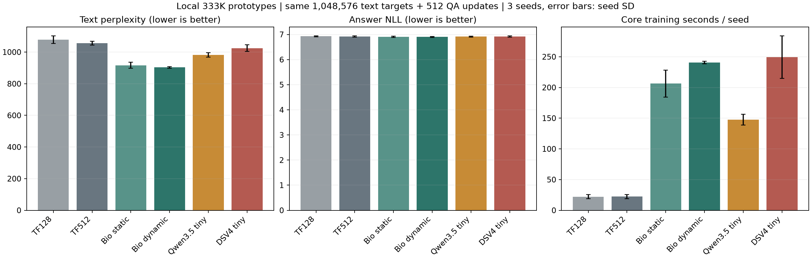

# 本地33万参数：Bio、Qwen与DeepSeek同预算评估

2026-11-03。新增Qwen3.5与DeepSeek-V4缩小原型各三种子，6/6条训练全部完成。每条1024次更新；全部6144步输入与监督mask的SHA256均与原V3同种子、同更新位置完全匹配。原V3四组结果保留，0.133B队列保持未启动。

## 结论

在这套本地极小规模和旧训练预算下，Bio动态版的文本预测最好；Qwen与DeepSeek原型同样没有建立基础问答能力。动态Bio文本PPL为902.826，Qwen原型982.251，DeepSeek原型1024.990，分别低约8.09%和11.92%。三个种子中均保持这一文本排名。

六种模型的首答案token命中率均为0%。在seed11的同64道验证问答上独立生成，六组EM/F1也全部为0%。输出主要重复`the`，少数变为重复字符，全部达到50-token上限。现有低预算下，成熟架构的这些缩小实现也未形成可用问答。

这些共同失败进一步支持容量与训练不足是优先研究因素。容量、训练量、默认初始化和训练配方各自的贡献，需要后续隔离对照确定。

## 对齐条件

- 4096词表、相同冻结WikiText-2与SQuAD派生数据、FP32、本机MPS、种子11/23/37。
- 每模型512次文本更新，共1,048,576个有效目标；随后512次问答更新、batch4，共2048次问答样本抽取。seed11实际答案监督为12,926个token。
- 沿用原答案mask、学习率、阶段热身、权重衰减及裁剪。旧问答阶段的EOS监督缺口保留。
- 新原型的初始词嵌入复制原Bio同种子的初始词嵌入，其余参数采用公共实现初始化。全部从零训练。
- 文本验证为64个窗口、28篇文档、8192个目标；问答为原64次抽取、20篇文章、475个答案目标。评分使用固定预算末尾检查点。

## 三种子均值

| 模型 | 总参数 | 文本PPL↓ | 答案NLL↓ | 首答案NLL↓ | 首token命中 | 核心更新秒/种子↓ |
|---|---:|---:|---:|---:|---:|---:|
| 原Transformer，128窗口 | 333,106 | 1078.345 | 6.925408 | 7.488867 | 0% | 22.11 |
| 原Transformer，512窗口 | 333,106 | 1056.412 | 6.916758 | 7.482149 | 0% | 22.30 |
| 原Bio静态地址 | 333,136 | 916.314 | 6.901393 | 7.290911 | 0% | 206.28 |
| 原Bio动态 | 333,136 | **902.826** | 6.901476 | 7.283738 | 0% | 240.37 |
| Qwen3.5缩小原型 | 332,950 | 982.251 | 6.915628 | 7.362457 | 0% | 147.32 |
| DeepSeek-V4缩小原型 | 333,065 | 1024.990 | 6.917841 | 7.385365 | 0% | 249.43 |

文本PPL使用本项目BPE，限于本表同口径比较。时间为前向、反向、裁剪和优化器更新之和；采样、验证、日志、哈希和存盘不计入。

Qwen原型的核心更新耗时约为Bio动态的61.3%，也约为普通512窗口Transformer的6.61倍。DeepSeek原型约为Bio动态的1.04倍、普通Transformer的11.18倍。DeepSeek三个种子的时长约210.5、261.1、276.7秒，波动明显；原四模型来自此前运行时段。这是本机参考实现的操作成本，CUDA融合核性能仍需实测。

## 稳定性与统计

下表为新原型减动态Bio的NLL；正数表示新原型较高。对三个种子和同一组评估文档进行交叉重采样，共20000次；问答20篇文章，文本28篇文档。

| 比较 | 任务 | NLL差 | 交叉bootstrap 95%区间 |
|---|---|---:|---|
| Qwen−Bio动态 | 文本 | +0.084263 | [+0.065110, +0.103957] |
| DeepSeek−Bio动态 | 文本 | +0.126784 | [+0.108799, +0.143590] |
| Qwen−Bio动态 | 问答 | +0.014152 | [−0.010023, +0.042950] |
| DeepSeek−Bio动态 | 问答 | +0.016365 | [−0.014584, +0.050466] |

文本优势在本轮种子与验证样本变化中稳定。问答NLL的差异区间跨零，且首token全部失败。后续答案token在teacher forcing中能看到前面的正确答案token，平均答案NLL下降仍可能主要来自答案分布和词语搭配。

## 实际逐题生成

固定seed11，从每题相同的原始历史/问题前缀独立开始；贪心、遇EOS结束，最多50个本项目BPE token。六模型共用每题生成额度，确保最后一次模型输入不超过原512长度；本批64题的额度实际均为50。原始参考答案只参与评分。

| 模型 | 题数 | EM | SQuAD词级F1 | 达到长度上限 | 最常见输出覆盖 |
|---|---:|---:|---:|---:|---:|
| Transformer128 | 64 | 0% | 0% | 100% | 63/64 |
| Transformer512 | 64 | 0% | 0% | 100% | 63/64 |
| Bio静态 | 64 | 0% | 0% | 100% | 63/64 |
| Bio动态 | 64 | 0% | 0% | 100% | 63/64 |
| Qwen原型 | 64 | 0% | 0% | 100% | 63/64 |
| DeepSeek原型 | 64 | 0% | 0% | 100% | 64/64 |

最常见输出均为50次`the`。Transformer与Qwen另有一题重复字符`s`；Bio另有一题出现极短的不同前缀后重复`the`。全部384条原始预测、生成token和参考答案保存在本地`.private.json`；公开副本提供净化数值投影与预测哈希。

这项自由生成是同一批SQuAD派生验证题的附加诊断，独立于此前LoCoMo实验。新两种架构的完整LoCoMo评分未执行。

## 缩小后的参数分配

| 模型 | 词嵌入 | FFN/专家内容参数 | 超连接参数 | 其他混合、路由与归一化 |
|---|---:|---:|---:|---:|
| Transformer512 | 229,376 | 78,082 | 0 | 25,648 |
| Bio动态 | 229,376 | 61,584 | 0 | 42,176 |
| Qwen原型 | 229,376 | 54,432 | 0 | 49,142 |
| DeepSeek原型 | 229,376 | 26,880 | 44,125 | 32,684 |

各模型约69%的参数用于词嵌入，序列处理部分仅约10.4万参数。DeepSeek的mHC在这套微型配置中占非嵌入参数42.6%，其结构开销在小尺度十分显著。相同总参数预算下，不同架构可用于内容变换的容量差别很大。

## 参考实现与范围

直接使用Transformers 5.22.1的[Qwen3.5参考实现](https://huggingface.co/docs/transformers/model_doc/qwen3_5)和[DeepSeek-V4参考实现](https://huggingface.co/docs/transformers/model_doc/deepseek_v4)。两者缩至四层56维以容纳组件；原Bio保持两层。新模型仍是本项目选择的微型配置，参数、初始化和各层类型完整保存。

Qwen保留3层Gated DeltaNet加1层完整注意力、SwiGLU与RMSNorm，微型头采用全头RoPE。DeepSeek保留局部/CSA/HCA压缩注意力、低秩分组输出、4路mHC和4个路由专家Top2加共享专家，词嵌入/输出共同绑定；估计每token激活参数322,313。Hash专家表做可复现且不重复的初始化。使用公共实现0.001负载均衡辅助项，官方无辅助损失路由偏置调度未实现。512长度下topk512保留所有CSA压缩条目，索引器蒸馏和稀疏长上下文收益均未测试；MTP未实例化。

本轮匹配参数、样本与训练预算；FLOPs、深度、运行态和专用训练控制不同。Mac使用FP32公开参考算子，专用CUDA GDN/MoE融合核、每架构超参数搜索、等时间训练和更大规模未执行。验证集已用于多轮探索，独立最终测试保留。

## 完整性与文件

新增6条全部completed；failed、aborted、not_executed均为0。3项自检通过，覆盖参数/绑定/Hash表、因果性与独立前缀、原生MPS反向。6144步样本/mask哈希均通过，目标计数与原同种子一致。全部64份实验/历史源文件保持冻结；原58份V3源码、seed11四个旧检查点与0.133B队列源码也核对未变。

完整统计见[statistics.json](statistics.json)，逐题生成摘要见[generation_summary.json](generation_summary.json)，参数分配见[component_budgets.json](component_budgets.json)，配对审计见[audit.json](audit.json)，保留性核对见[preservation_audit.json](preservation_audit.json)。新增训练原始数值位于各条件的`metrics.jsonl`，协议见[protocol.json](../protocol.json)，入口与复跑条件见[说明](../../../../evaluations/tiny_arch/README.md)。

