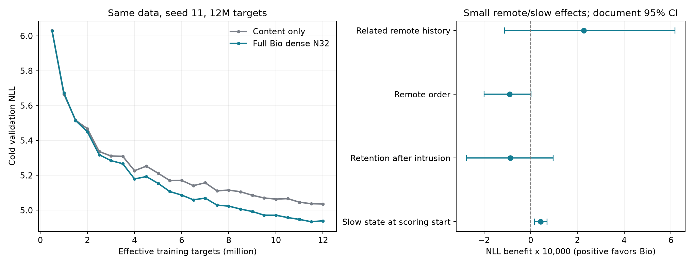

# v0.9 dense N32 seed11 最终结果

> 归档说明：本文保留写作时点的设计或状态。项目已停止v0.9后续训练；最新执行状态见[实验索引](../../../../docs/RESULTS_INDEX.md)。公开副本不含权重与语料。

12M 有效目标、94,422 次更新和暖历史评估全部完成。主比较使用 last，冷验证 best 为 11.5M 时的 4.933975，12M last 为 4.939364，末段趋平并轻微回升。

**完整 Bio 的预测收益明确，远史与 slow 的实用收益很弱。** 本条结果支持继续保留完整架构研究，同时把长期记忆的写入、保持与读取归因列为下一项诊断。

| 共同评估 | content_only | dense | 改善 |
|---|---:|---:|---:|
| 冷验证 NLL | 5.036041 | 4.939364 | 0.096677 |
| 冷验证 PPL | 153.860 | 139.681 | 降低 9.22% |
| 暖历史 A0R NLL | 5.051925 | 4.913514 | 0.138411 |
| 暖历史 A0R PPL | 156.323 | 136.117 | 降低 12.93% |

暖评估为同一 sample hash、64 窗、30 文档、16,384 个不重复评分目标。独立从零训练模型之间的暖 NLL 差按文档重采样 10,000 次，95% 区间 [0.118723, 0.160130]；这个区间只覆盖评估样本文档变化。

## 机制归因

| 干预差值 | ΔNLL | 文档 bootstrap 95% 区间 |
|---|---:|---|
| Related remote history | 0.00022756 | [-0.00011239, 0.00061723] |
| Remote order | -0.00008961 | [-0.00019883, 0.00000162] |
| Retention after intrusion | -0.00008736 | [-0.00027459, 0.00009582] |
| Slow state at scoring start | 0.00004216 | [0.00001681, 0.00006939] |
| 关闭完整 Bio 读出 | 0.23876236 | [0.21389283, 0.26525264] |

正值表示保留相应条件有利。相关远史、远史顺序和干扰后保留的证据很弱。清 slow 与 credit_only 对齐消除旧信用影响；清除发生在评分前，评分时仍允许按原规则重新写入，因此它衡量的是暖前缀积累的 slow 在后续评分中的贡献，而非全程禁止 slow 的作用。

关闭 Bio 读出使 NLL 从 credit_only 的 4.913514 升至 5.152277，说明已训练模型依赖完整 Bio 分支。该分支同时含 fast/m/slow、当前内容经图处理等，仍需局部分离才能定位收益。base_only 的 5.152277 比独立训练 content_only 的 5.051925 更差，符合两条分支共同适应后的干预行为，不能把 0.238762 全计作历史收益。

冷窗口内也会积累几十 token 的状态，不能把“冷验证获益”直接归成无状态的静态计算。当前证据允许近期状态、节点计算和额外表示能力共同解释总体增益。

## 速度与下一步

dense 累计数值更新耗时 6.647 小时，平均 501.5 有效目标/s；content_only 为 294.7 秒。dense 数值核心耗时约 81.2 倍，验证、采样、记录和保存另计。content_only 是当前内容基线，Transformer 尚未完成，不能用此比值替代 Transformer 比较。

保留当前队列，继续 sparse、Transformer 与 N128/N512 的配对实验。后续诊断优先区分近史与远史收益，分别定位 fast/m/slow 的读取贡献、slow 写入尺度与参数梯度、评分期间恢复速度。先做同检查点干预和小规模诊断，再决定更改学习率、衰减、路由或容量；不由本条小规模结果取消大规模资格。

详细数值、输入文件哈希和口径保存在 analysis.json；原始训练、检查点和评估均保持原样。本次未执行新推理/训练。
