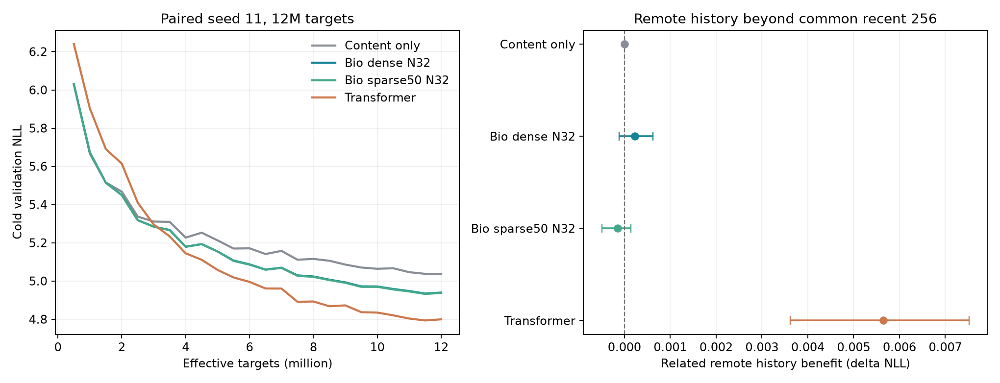

# N32 seed11 四模型最终比较

> 归档说明：本文保留写作时点的设计或状态。项目已停止v0.9后续训练；最新执行状态见[实验索引](../../../../docs/RESULTS_INDEX.md)。公开副本不含权重与语料。

四条独立训练与暖历史评估完成，均为12M有效目标的last检查点。共同训练流、源码、数据哈希一致，冷验证和暖评估目标一致。

**本条配对结果中，Transformer 的预测质量、远史利用和训练速度均领先 Bio。N128 dense 仍在训练，不能把它计为完成。**

| 模型 | 参数 | 冷NLL | 暖NLL | 暖PPL | 数值训练分钟 |
|---|---:|---:|---:|---:|---:|
| Content only | 303,680 | 5.036041 | 5.051925 | 156.323 | 4.91 |
| Bio dense N32 | 315,817 | 4.939364 | 4.913514 | 136.117 | 398.80 |
| Bio sparse50 N32 | 315,817 | 4.937495 | 4.912728 | 136.010 | 427.61 |
| Transformer | 316,608 | 4.799269 | 4.727059 | 112.963 | 16.45 |

## 历史贡献

| 模型 | 相关远史ΔNLL | 文档95%区间 | 干扰后历史保留ΔNLL |
|---|---:|---|---:|
| Content only | 0.00000000 | [0.00000000, 0.00000000] | 0.00000000 |
| Bio dense N32 | 0.00022756 | [-0.00011239, 0.00061723] | -0.00008736 |
| Bio sparse50 N32 | -0.00014546 | [-0.00049282, 0.00013589] | -0.00008995 |
| Transformer | 0.00564309 | [0.00362016, 0.00751907] | 0.00457510 |

Transformer 比 dense 的暖 NLL 低 0.186455，PPL 低 17.01%；dense 数值核心耗时为其 24.25 倍。配对文档重采样的暖NLL差区间为 [0.160993, 0.209814]。这不是训练种子区间。

同一远史测试在 Transformer 上给出正收益，说明该协议能够检出一部分远史信号；本次 Bio 没有有效利用这些信号。该判断限于完成的N32/seed11，不代替尚未完成的规模与重复种子实验。所有状态是否无用，仍需保留当前输入计算、单独干预近期/跨块状态来检验。

N32 sparse50最终冷NLL比dense约低0.001869，暖NLL约低0.000786；它全程执行32/32节点，后期多了路由增益，数值核心耗时比dense多约7.2%。这条结果没有展示减少节点的性能收益。

相同参数规模和输入机会，并未固定持久运行态字节或FLOPs。Transformer保存显式KV，Bio以固定节点矩阵压缩历史，状态策略不同。速度是相同数据预算的实际实现成本，包含各自反向/裁剪/优化器和状态收尾；验证、记录与保存另计。

详细数值、当前队列状态、输入文件哈希见analysis.json。仅离线分析和CPU模型参数计数，没有运行新forward、GPU训练或修改生产源码。
