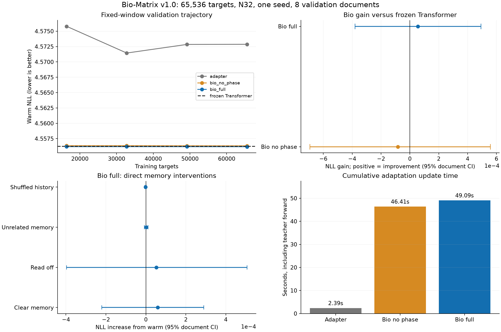

# Bio-Matrix v1.0 首轮结果分析

**本轮完整Bio几乎保持冻结Transformer的原始预测，历史内容的增益极小；当前质量收益不足以支撑额外计算成本。**

三种适配各完成65,536有效目标、64次更新，逐步训练样本SHA完全相同。冻结Transformer只评分。44项自检通过，归档源码SHA匹配。原始记录见[summary](../../summary.json)和[protocol](../../protocol.json)。

## 固定末尾检查点

| 条件 | 暖NLL↓ | 暖PPL↓ | 核心适配秒 |
|---|---:|---:|---:|
| transformer | 4.556242168 | 95.224967 | 0.000 |
| adapter | 4.572865963 | 96.821198 | 2.385 |
| bio_no_phase | 4.556324780 | 95.232834 | 46.406 |
| bio_full | 4.556186199 | 95.219638 | 49.092 |

完整Bio对冻结TF的平均NLL改善为0.000055969，PPL改善0.00560%。8个文档中只赢3个。full−TF配对区间为[-0.0004928708076477051, 0.0003807544708251953]，跨零。相位组对无相位组的NLL改善约0.000139，区间同样跨零。

完整组更新时间为Adapter的20.58倍。两者同预算、额外可训练参数接近；计时包含教师前向，排除数据采样、验证和保存。冻结TF本轮没有训练，不能把这项比例当作相对TF训练速度。

## 记忆的直接作用

完整组清空Bio经验后NLL增加0.000059247；评分时关闭读取增加0.000052094；移植错配远史增加0.000002205；打乱历史变化-0.000001252。各项文档区间均跨零。进入评分时注意力KV、位置和时钟相同。

正常暖状态相对冷启动的改善约0.049652 NLL；普通冻结Transformer也获得约0.049578。这轮暖状态的大部分收益已有普通注意力上下文提供，Bio额外历史内容的贡献很小。

## 机制覆盖缺口

检查点只读统计见[分层状态统计](../field_dynamics_readonly_review.json)。默认J=2的传播使最外层18/32节点没有fresh观测支持，P保持初值、slow为零；完整相位组该层fast也近乎为零。相位本身在演化，但空间层没有充分参与新观测学习。需要补分层到达率验收，并修正默认传播覆盖。

每次更新从独立512-token文档窗开始。支持量与运行态不跨全部64次更新累积；参数巩固只在最后一步执行，主要涉及两层的中心节点。该轮尚无关闭巩固或同权重巩固前后评分，无法单独量化长期固化收益。

## 下一步优先级

先校准传播到达与实际读出幅度，记录每层各壳的有效观测/写入/输出贡献；再用有明确历史需求的监督和完整采样窗口教师训练写读。参数巩固需要多次触发与独立关闭对照。完成这些检查后，再决定增加训练预算和节点规模。

Adapter训练目标降低而固定验证变差。Top-64重归一化蒸馏会同时推动概率集中，其相对教师条件、真实CE和验证表现之间的关系需要单独审计；当前证据不能确认这是唯一原因。

## 范围

一个训练种子、8个不同验证文档、1,024评分目标；文档bootstrap只描述固定模型的抽样变动，不能代表训练种子不确定性。验证集曾被多轮研究使用，test未评估。没有执行新的模型前向、优化或长训练，原始结果未改动。

